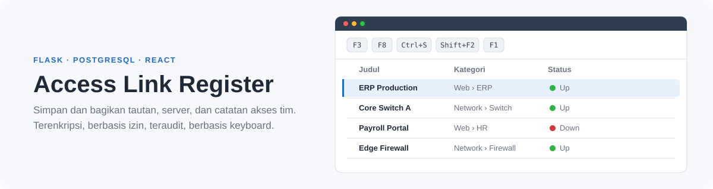
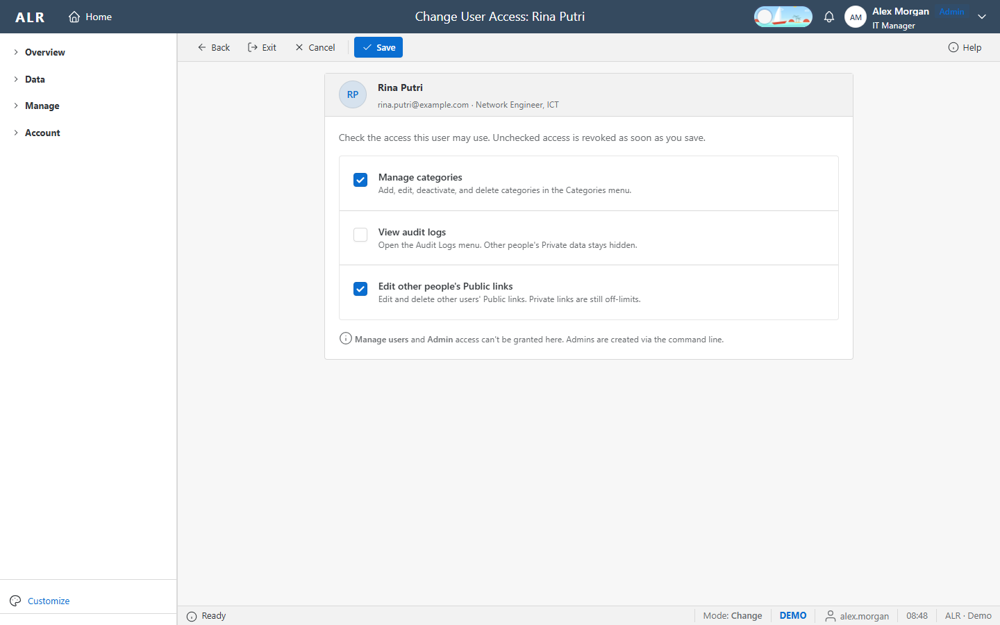
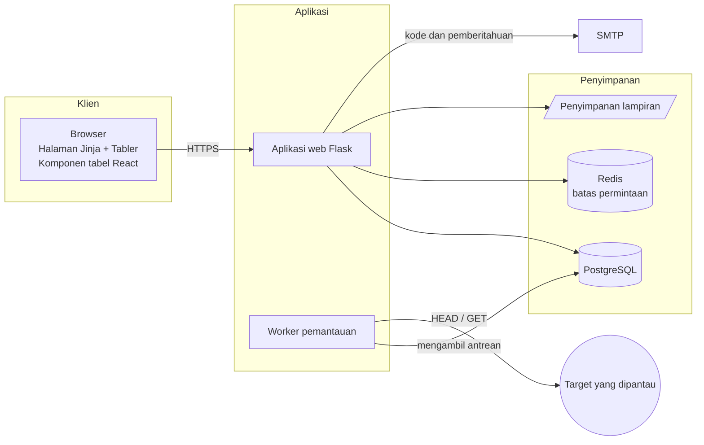
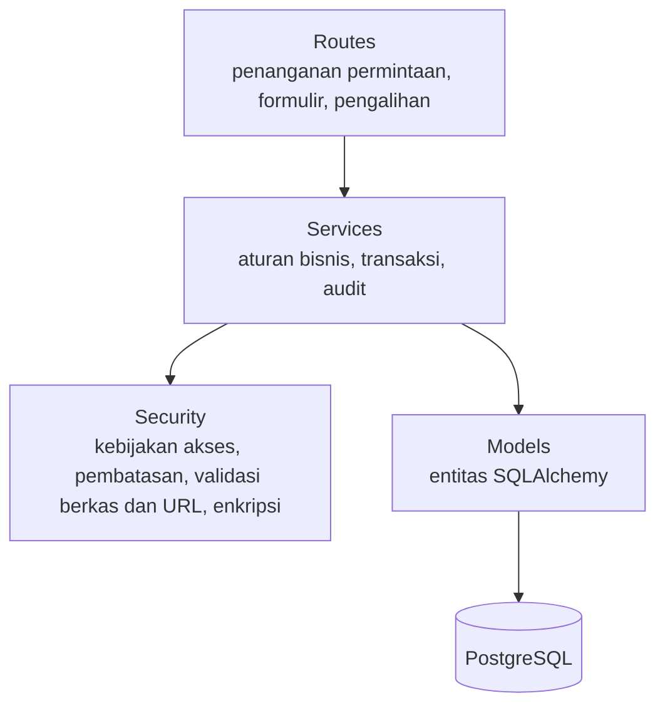
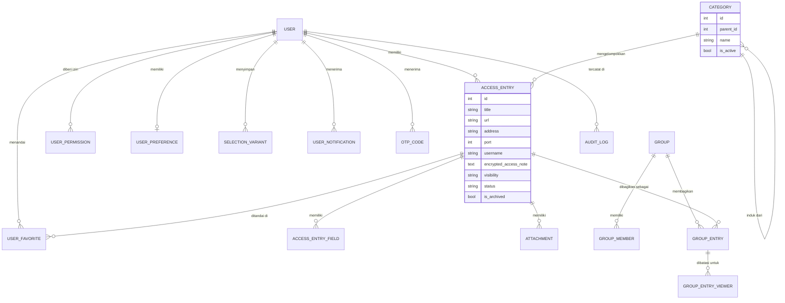
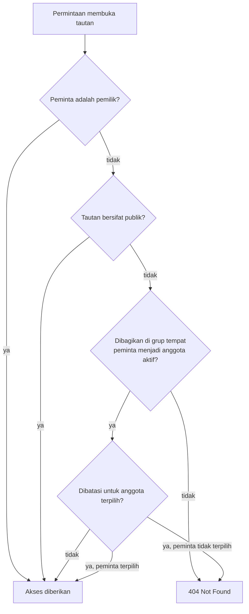
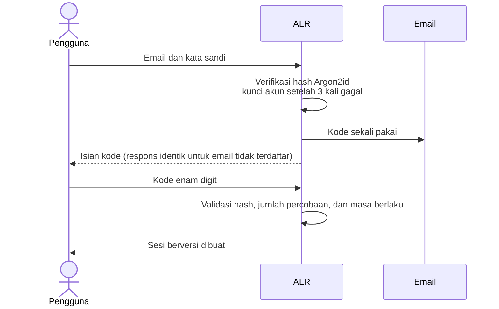
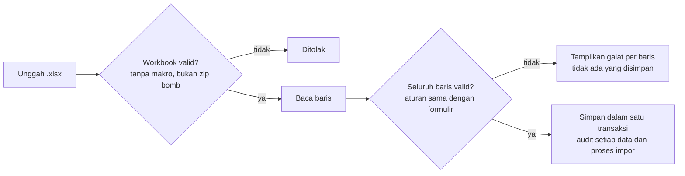

<p align="center">
  <a href="README.md"></a>
  <a href="README.id.md"></a>
</p>

<picture>
  <source media="(prefers-color-scheme: dark)" srcset="assets/banner-id-dark.svg">
  
</picture>

<h1 align="center">Access Link Register</h1>

<p align="center">
  Aplikasi web internal yang aman untuk mengelola dan membagikan informasi akses di lingkungan tim ICT.<br>
  Terenkripsi saat disimpan, berbasis izin, teraudit penuh, dan dirancang untuk alur kerja berbasis keyboard yang terinspirasi SAP GUI.
</p>

<p align="center">
  <a href="#ikhtisar">Ikhtisar</a> &nbsp;·&nbsp;
  <a href="#tangkapan-layar">Tangkapan Layar</a> &nbsp;·&nbsp;
  <a href="#fitur">Fitur</a> &nbsp;·&nbsp;
  <a href="#kontrol-akses">Kontrol Akses</a> &nbsp;·&nbsp;
  <a href="#arsitektur">Arsitektur</a> &nbsp;·&nbsp;
  <a href="#keamanan">Keamanan</a> &nbsp;·&nbsp;
  <a href="#penjaminan-mutu">Mutu</a> &nbsp;·&nbsp;
  <a href="#memulai">Memulai</a>
</p>

<p align="center">
  
</p>

> [!NOTE]
> Sistem ini dikembangkan untuk penggunaan internal dan dipublikasikan sebagai proyek portofolio atas izin organisasi. Repositori ini tidak memuat data organisasi, kredensial, maupun detail infrastruktur. Seluruh tangkapan layar menggunakan data demo sintetis.

<br>

## Ikhtisar

Access Link Register (ALR) merupakan sumber data tunggal untuk informasi akses yang digunakan tim ICT setiap hari: URL aplikasi, alamat server dan perangkat jaringan, serta petunjuk akses yang diperlukan untuk mengaksesnya.

Aplikasi ini dirancang berdasarkan tiga prinsip:

| Prinsip | Penerapan |
|---|---|
| **Kerahasiaan** | Catatan akses dienkripsi saat disimpan, tidak pernah disertakan dalam markup halaman, dan hanya ditampilkan atas permintaan eksplisit |
| **Akuntabilitas** | Setiap perubahan, aktivitas masuk, dan ekspor dicatat dalam log audit yang tidak dapat diubah |
| **Efisiensi** | Konvensi SAP GUI (tombol fungsi, layar seleksi, varian, tabel ALV) bagi pengguna yang bekerja dengan sistem ERP setiap hari |

<div align="center">

| 16 | 68 | 18 | 26 | 780+ |
|:---:|:---:|:---:|:---:|:---:|
| layar | endpoint HTTP | tabel basis data | migrasi skema | pengujian otomatis |

</div>

### Teknologi

| Lapisan | Teknologi |
|---|---|
| Backend | Python 3.13, Flask 3.1, SQLAlchemy 2.0, Alembic |
| Basis data | PostgreSQL 17 |
| Frontend | Templat Jinja, Tabler UI, komponen React 19 yang dibangun dengan Vite |
| Keamanan | Argon2id, Fernet (AES), CSRF Flask-WTF, Flask-Limiter dengan Redis, sanitasi nh3 |
| Dokumen | openpyxl dengan defusedxml untuk impor dan ekspor Excel |
| Pengujian | pytest, Vitest, Testing Library, Chrome headless melalui DevTools Protocol |

<br>

## Tangkapan Layar

Pilih salah satu kelompok untuk membukanya. Gambar menyesuaikan tema GitHub yang sedang aktif.

<details open>
<summary><b>Dasbor</b> &nbsp;·&nbsp; Tampilan beranda khusus untuk setiap peran.</summary>
<br>
<table>
  <tr>
    <td width="50%" valign="top">
      <picture>
        <source media="(prefers-color-scheme: dark)" srcset="assets/dashboard-admin-dark.png">
        
      </picture>
      <p align="center"><b>Administrator</b><br><sub>Ringkasan sistem, tugas administrasi, dan aktivitas tim lengkap</sub></p>
    </td>
    <td width="50%" valign="top">
      <picture>
        <source media="(prefers-color-scheme: dark)" srcset="assets/dashboard-entry-dark.png">
        
      </picture>
      <p align="center"><b>User Entry</b><br><sub>Metrik pribadi dan panduan memulai</sub></p>
    </td>
  </tr>
  <tr>
    <td width="50%" valign="top">
      <picture>
        <source media="(prefers-color-scheme: dark)" srcset="assets/login-dark.png">
        
      </picture>
      <p align="center"><b>Masuk</b><br><sub>Langkah 1 dari 2: verifikasi kata sandi sebelum kode sekali pakai</sub></p>
    </td>
  </tr>
</table>
</details>

<details>
<summary><b>Pengelolaan Tautan</b> &nbsp;·&nbsp; Mencari, meninjau, membuat, dan mengimpor data.</summary>
<br>
<table>
  <tr>
    <td width="50%" valign="top">
      <picture>
        <source media="(prefers-color-scheme: dark)" srcset="assets/links-dark.png">
        
      </picture>
      <p align="center"><b>Daftar Tautan</b><br><sub>Tabel bergaya ALV dengan filter, status, tombol salin, dan pilihan massal</sub></p>
    </td>
    <td width="50%" valign="top">
      <picture>
        <source media="(prefers-color-scheme: dark)" srcset="assets/detail-dark.png">
        
      </picture>
      <p align="center"><b>Detail Tautan</b><br><sub>Catatan akses tersamar, status ketersediaan, dan riwayat perubahan</sub></p>
    </td>
  </tr>
  <tr>
    <td width="50%" valign="top">
      <picture>
        <source media="(prefers-color-scheme: dark)" srcset="assets/form-dark.png">
        
      </picture>
      <p align="center"><b>Tambah Tautan</b><br><sub>Pemilihan kategori bertingkat dan pengaturan visibilitas</sub></p>
    </td>
    <td width="50%" valign="top">
      <picture>
        <source media="(prefers-color-scheme: dark)" srcset="assets/import-dark.png">
        
      </picture>
      <p align="center"><b>Impor Excel</b><br><sub>Unduh templat dan unggah secara transaksional</sub></p>
    </td>
  </tr>
</table>
</details>

<details>
<summary><b>Administrasi</b> &nbsp;·&nbsp; Layar untuk administrator dan pengguna yang diberi wewenang.</summary>
<br>
<table>
  <tr>
    <td width="50%" valign="top">
      <picture>
        <source media="(prefers-color-scheme: dark)" srcset="assets/users-dark.png">
        
      </picture>
      <p align="center"><b>Manajemen Pengguna</b><br><sub>Layar seleksi, status akun, peran, dan tindakan</sub></p>
    </td>
    <td width="50%" valign="top">
      <picture>
        <source media="(prefers-color-scheme: dark)" srcset="assets/user-access-dark.png">
        
      </picture>
      <p align="center"><b>Pemberian Akses</b><br><sub>Memberikan atau mencabut izin tambahan</sub></p>
    </td>
  </tr>
  <tr>
    <td width="50%" valign="top">
      <picture>
        <source media="(prefers-color-scheme: dark)" srcset="assets/categories-dark.png">
        
      </picture>
      <p align="center"><b>Manajemen Kategori</b><br><sub>Hingga empat tingkat dengan kategori bawaan dan kustom</sub></p>
    </td>
    <td width="50%" valign="top">
      <picture>
        <source media="(prefers-color-scheme: dark)" srcset="assets/monitoring-dark.png">
        
      </picture>
      <p align="center"><b>Pemantauan Tautan</b><br><sub>Mengantrekan pemeriksaan ketersediaan dan memantau progresnya</sub></p>
    </td>
  </tr>
</table>
</details>

<details>
<summary><b>Kolaborasi dan Akun</b> &nbsp;·&nbsp; Jejak audit, grup, pengaturan, dan bantuan.</summary>
<br>
<table>
  <tr>
    <td width="50%" valign="top">
      <picture>
        <source media="(prefers-color-scheme: dark)" srcset="assets/audit-dark.png">
        
      </picture>
      <p align="center"><b>Log Audit</b><br><sub>Catatan permanen atas perubahan, aktivitas masuk, dan ekspor</sub></p>
    </td>
    <td width="50%" valign="top">
      <picture>
        <source media="(prefers-color-scheme: dark)" srcset="assets/group-dark.png">
        
      </picture>
      <p align="center"><b>Detail Grup</b><br><sub>Berbagi tautan terpilih dengan anggota yang diundang</sub></p>
    </td>
  </tr>
  <tr>
    <td width="50%" valign="top">
      <picture>
        <source media="(prefers-color-scheme: dark)" srcset="assets/settings-dark.png">
        
      </picture>
      <p align="center"><b>Pengaturan</b><br><sub>Pemeliharaan profil dan penggantian kata sandi</sub></p>
    </td>
    <td width="50%" valign="top">
      <picture>
        <source media="(prefers-color-scheme: dark)" srcset="assets/help-dark.png">
        
      </picture>
      <p align="center"><b>Bantuan (F1)</b><br><sub>Bantuan kontekstual dan daftar lengkap pintasan keyboard</sub></p>
    </td>
  </tr>
</table>
</details>

<br>

## Fitur

Buka setiap modul untuk melihat kemampuannya.

<details>
<summary><b>Register Tautan</b> &nbsp;·&nbsp; data inti</summary>
<br>

| Kemampuan | Keterangan |
|---|---|
| Jenis data | URL, host atau alamat IP beserta port, atau panduan terstruktur dengan hingga sepuluh kolom tambahan yang ditulis lewat editor teks ala Word (disanitasi dan tidak dienkripsi, jadi bukan untuk kata sandi) |
| Kategorisasi | Kategori bertingkat hingga empat level (misalnya Web › ERP), dipilih melalui isian berjenjang |
| Visibilitas | Private (hanya pemilik) atau Public (seluruh pengguna, hanya baca); tautan Public hanya dapat dibuat administrator, sehingga tautan dari pengguna lain, termasuk hasil impor, disimpan sebagai Private |
| Catatan akses | Petunjuk akses singkat (misalnya masuk via SSO), bukan kata sandi; dienkripsi di basis data dan disamarkan hingga pengguna secara eksplisit membukanya |
| Lampiran | Hingga lima berkas per data: gambar, PDF, Excel, Word, dan teks |
| Favorit | Menandai data dan menyaring daftar khusus favorit |
| Arsip | Memindahkan tautan yang tidak dipakai ke arsip; tautan yang diarsipkan tetap terlihat dengan label Archived, selalu ditampilkan di bawah tautan aktif, dan dapat dikembalikan |
| Riwayat | Catatan kronologis pembuatan dan perubahan untuk setiap tautan |
| Impor | Templat Excel dengan pilihan tervalidasi; seluruh baris diproses dalam satu transaksi utuh |
| Ekspor | Berkas Excel dari hasil pencarian aktif, dilengkapi lembar ringkasan |

</details>

<details>
<summary><b>Konvensi SAP GUI</b> &nbsp;·&nbsp; familier bagi pengguna ERP</summary>
<br>

| Elemen | Keterangan |
|---|---|
| Toolbar aplikasi | Back, Exit, Cancel, Save, dan Help pada posisi tetap; tindakan yang tidak tersedia dinonaktifkan |
| Tombol fungsi | Setiap tindakan pada toolbar memiliki tombol keyboard (lihat [Referensi Keyboard](#referensi-keyboard)) |
| Layar seleksi | Kriteria pencarian dengan pola wildcard (`ad*`, `*ad`, `*ad*`) dan beberapa nilai per kolom |
| Varian | Kumpulan kriteria seleksi yang disimpan dengan nama dan dapat digunakan kembali |
| Tabel bergaya ALV | Pengurutan, filter per kolom, kolom yang dapat diatur dan disembunyikan per pengguna, baris aktif, menu konteks |
| Status bar | Riwayat pesan, mode layar, lingkungan, pengguna aktif, dan jam |

</details>

<details>
<summary><b>Dasbor Berbasis Peran</b> &nbsp;·&nbsp; disesuaikan untuk setiap peran</summary>
<br>

| Peran | Isi Dasbor |
|---|---|
| Administrator | Jumlah pengguna, akun terkunci dan nonaktif, ketersediaan tautan, waktu pemeriksaan terakhir, serta daftar tugas administrasi |
| User Entry | Metrik pribadi, data yang memerlukan perhatian, dan panduan memulai |

Setiap peran dilengkapi **umpan aktivitas tim**. Tindakan yang berulang digabungkan menjadi satu entri per orang per hari agar umpan tetap ringkas. Pengguna biasa hanya melihat aktivitas publik; peristiwa akun dan keamanan hanya dapat dilihat administrator.

</details>

<details>
<summary><b>Grup</b> &nbsp;·&nbsp; berbagi secara terkendali</summary>
<br>

- Membuat grup dan mengundang anggota melalui email; undangan dapat diterima atau ditolak
- Membagikan tautan milik sendiri atau tautan publik ke dalam grup
- Membatasi tautan tertentu hanya untuk anggota terpilih
- Pemilik grup menentukan anggota yang boleh menambahkan tautan

</details>

<details>
<summary><b>Pemantauan Tautan</b> &nbsp;·&nbsp; pemeriksaan ketersediaan</summary>
<br>

- Administrator mengantrekan pemeriksaan dari antarmuka web; proses worker khusus yang menjalankannya
- Progres ditampilkan secara langsung; hasilnya muncul sebagai Up, Down, atau Not Checked di seluruh aplikasi
- Setiap target, termasuk setiap pengalihan (redirect), divalidasi terhadap rentang alamat privat, loopback, dan metadata cloud

</details>

<details>
<summary><b>Akun dan Identitas</b> &nbsp;·&nbsp; autentikasi dan preferensi</summary>
<br>

- Pendaftaran mandiri yang dibatasi pada domain email perusahaan, dikonfirmasi dengan kode verifikasi
- Masuk dua langkah: kata sandi, kemudian kode sekali pakai yang dikirim melalui email
- Pemulihan kata sandi, penggantian kata sandi, dan pemeliharaan profil
- Notifikasi dalam aplikasi untuk perubahan izin, upaya masuk yang diblokir, dan penggantian kata sandi
- Tema terang dan gelap, warna aksen, pilihan huruf, dan tata letak ringkas

</details>

<br>

## Kontrol Akses

Sistem ini memiliki dua peran. Administrator dapat mendelegasikan izin tertentu kepada pengguna biasa.

<div align="center">

| Tindakan | User Entry | Administrator |
|---|:---:|:---:|
| Membuat, mengubah, dan menghapus tautan milik sendiri | ✓ | ✓ |
| Membuat tautan publik | – | ✓ |
| Melihat dan menyalin tautan publik | ✓ | ✓ |
| Melihat tautan privat milik pengguna lain | – | – |
| Membuat grup dan membagikan tautan | ✓ | ✓ |
| Mengimpor dan mengekspor berkas Excel | ✓ | ✓ |
| Mengelola kategori | jika diberikan | ✓ |
| Mengubah atau menghapus tautan publik milik pengguna lain | jika diberikan | ✓ |
| Melihat log audit | jika diberikan | ✓ |
| Mengelola pengguna dan mendelegasikan izin | – | ✓ |
| Menjalankan pemantauan tautan | – | ✓ |
| Menghapus tautan secara massal | – | ✓ |

</div>

Tautan privat tetap bersifat privat bagi pemiliknya, termasuk terhadap administrator. Akun administrator hanya dapat dibuat melalui command line.

<br>

## Referensi Keyboard

<div align="center">

| Tombol | Tindakan | Tombol | Tindakan |
|:---:|---|:---:|---|
| <kbd>F3</kbd> | Kembali | <kbd>F1</kbd> | Bantuan kontekstual |
| <kbd>Shift</kbd> + <kbd>F3</kbd> | Keluar ke dasbor | <kbd>/</kbd> | Fokus ke pencarian cepat |
| <kbd>F12</kbd> | Batalkan perubahan | <kbd>↑</kbd> <kbd>↓</kbd> | Pindah baris aktif tabel |
| <kbd>Ctrl</kbd> + <kbd>S</kbd> | Simpan | <kbd>Enter</kbd> | Buka baris aktif |
| <kbd>F8</kbd> | Jalankan seleksi | <kbd>Shift</kbd> + <kbd>F10</kbd> | Menu konteks baris |
| <kbd>Shift</kbd> + <kbd>F2</kbd> | Hapus | <kbd>Esc</kbd> | Tutup dialog atau menu |

</div>

<br>

## Arsitektur

Buka setiap diagram untuk melihatnya. GitHub menampilkan diagram dengan kontrol perbesaran dan geser.

<details>
<summary><b>Konteks Sistem</b></summary>
<br>



Aplikasi web dan worker pemantauan berjalan sebagai proses terpisah dan hanya berkoordinasi melalui basis data, sehingga pemeriksaan yang berlangsung lama tidak pernah membebani permintaan web.

</details>

<details>
<summary><b>Lapisan Aplikasi</b></summary>
<br>



| Modul | Tanggung Jawab |
|---|---|
| `app/routes/` | Batas HTTP: pembacaan input, respons, dan pengalihan. Tidak memuat logika bisnis. |
| `app/services/` | Aturan bisnis, batas transaksi, dan pencatatan audit |
| `app/security/` | Kebijakan akses, pembatasan laju, validasi unggahan, validasi URL keluar, dan enkripsi |
| `app/models/` | Entitas dan batasan; seluruh perubahan skema dikelola dengan Alembic |
| `app/schemas/` | Definisi formulir dan layar seleksi |
| `frontend/` | Kode sumber React 19 dan Vite untuk tabel tautan, dikompilasi ke `app/static/dist` |

</details>

<details>
<summary><b>Model Data</b></summary>
<br>



Kategori dimodelkan sebagai adjacency list yang merujuk ke dirinya sendiri (`parent_id`), sehingga pengguna dapat menambahkan subkategori pada level mana pun tanpa perubahan skema.

</details>

<details>
<summary><b>Aturan Visibilitas</b></summary>
<br>



Aturan ini diterapkan sebagai satu predikat SQL yang digunakan oleh seluruh daftar, perhitungan, pencarian, ekspor, dan halaman detail, sehingga hasilnya selalu konsisten. Data yang tidak dapat diakses menghasilkan 404 agar keberadaannya tidak terungkap.

</details>

<details>
<summary><b>Alur Masuk</b></summary>
<br>



</details>

<details>
<summary><b>Alur Pemulihan Kata Sandi</b></summary>
<br>

```mermaid
sequenceDiagram
    actor U as Pengguna
    participant A as ALR
    participant E as Email
    U->>A: Alamat email
    A-->>U: Respons netral ("Jika email terdaftar, kode telah dikirim")
    A->>E: Kode pemulihan (hanya akun aktif)
    U->>A: Kode dan kata sandi baru
    A->>A: Validasi kode; batas percobaan per kode dan per email
    A->>A: Simpan hash baru, cabut semua sesi, buka kunci akun
    A->>E: Pemberitahuan penggantian kata sandi
    A-->>U: Arahkan ke halaman masuk
```

Kode pemulihan dan kode masuk disimpan dengan tujuan yang berbeda sehingga tidak dapat saling dipertukarkan.

</details>

<details>
<summary><b>Alur Pemantauan Tautan</b></summary>
<br>

```mermaid
sequenceDiagram
    actor Ad as Administrator
    participant W as Aplikasi web
    participant DB as Basis data
    participant K as Worker
    participant T as Target
    Ad->>W: Mulai pemeriksaan ketersediaan
    W->>DB: Antrekan satu proses
    K->>DB: Ambil proses dari antrean
    loop untuk setiap tautan
        K->>K: Validasi alamat target
        K->>T: Kirim permintaan; validasi setiap pengalihan
        K->>DB: Simpan status dan progres
    end
    Ad->>W: Periksa status proses
    W-->>Ad: Progres langsung, lalu ringkasan
```

</details>

<details>
<summary><b>Alur Impor Excel</b></summary>
<br>



</details>

<br>

## Keamanan

<div align="center">

| Ancaman | Mitigasi |
|---|---|
| Kebocoran basis data | Catatan akses dienkripsi dengan Fernet (AES); kata sandi di-hash dengan Argon2id; kode sekali pakai disimpan sebagai hash |
| Enumerasi akun | Proses masuk, pendaftaran, dan pemulihan kata sandi memberikan respons identik untuk email terdaftar maupun tidak |
| Serangan brute force | Pembatasan laju per IP dan per email; tiga kali salah kata sandi atau kode mengunci akun selama 15 menit, dan administrator dapat membukanya lebih awal |
| Pembajakan sesi | Sesi berversi; penggantian atau pemulihan kata sandi mencabut seluruh sesi lain |
| Akses data tanpa izin | Satu predikat visibilitas untuk seluruh kueri; data yang tidak dapat diakses menghasilkan 404 |
| Kebocoran catatan akses | Catatan akses tidak disertakan dalam markup halaman; setiap pembukaan merupakan permintaan terpisah yang diotorisasi |
| Cross-site scripting | Sanitasi input dan Content Security Policy yang hanya mengizinkan skrip milik aplikasi |
| Cross-site request forgery | Token pada setiap pengiriman formulir dan permintaan JSON |
| Unggahan berbahaya | Verifikasi tanda tangan berkas, deteksi makro dan zip bomb, serta parsing Excel yang aman dari XXE |
| Server-side request forgery | Rentang privat, loopback, dan metadata diblokir, termasuk pada pengalihan dan IPv6 |
| Kondisi balapan | Penguncian tingkat baris pada pembaruan penting, diverifikasi di PostgreSQL dengan permintaan bersamaan |
| Manipulasi audit | Catatan audit tidak dapat diubah maupun dihapus melalui aplikasi |

</div>

<br>

## Keputusan Desain

<details>
<summary><b>Adjacency list untuk kategori</b></summary>
<br>

Pengguna dapat membuat subkategori sendiri sehingga kedalaman hierarki tidak tetap. Satu tabel yang merujuk ke dirinya sendiri mendukung level apa pun dengan kueri yang seragam. Kedalaman dibatasi empat level pada lapisan service, dan seluruh pohon kategori cukup kecil untuk dimuat sekali per permintaan lalu disusun di memori.

</details>

<details>
<summary><b>Komponen React, bukan aplikasi satu halaman</b></summary>
<br>

Sebagian besar layar berupa formulir dan daftar yang sudah optimal dengan server rendering. Hanya tabel tautan yang membutuhkan perilaku interaktif di sisi klien (tata letak kolom, baris aktif, menu konteks, filter langsung), sehingga React hanya digunakan pada komponen tersebut. Hasil kompilasi disertakan dalam repositori sehingga menjalankan aplikasi tidak memerlukan Node.js.

</details>

<details>
<summary><b>Satu predikat visibilitas</b></summary>
<br>

Apabila daftar, perhitungan, ekspor, dan halaman detail masing-masing menerapkan aturan akses sendiri, aturan tersebut akan berbeda seiring waktu dan menyebabkan kebocoran data. Satu predikat digunakan bersama oleh seluruhnya, dan rangkaian pengujian memastikan tautan privat tidak pernah muncul di mana pun bagi pengguna yang tidak berwenang.

</details>

<details>
<summary><b>Worker pemantauan khusus</b></summary>
<br>

Pemeriksaan ratusan target dapat memakan waktu beberapa menit. Menjalankannya di dalam permintaan web akan menyebabkan timeout dan menghabiskan worker web. Antarmuka hanya mengantrekan proses; worker mengambilnya, menyimpan progres, dan dapat memulihkan proses yang terhenti.

</details>

<details>
<summary><b>Pengambilan catatan akses sesuai permintaan</b></summary>
<br>

Menyertakan catatan akses dalam markup halaman membuatnya terlihat oleh siapa pun yang dapat membaca sumber halaman, termasuk cache browser dan ekstensi. Mengambilnya hanya ketika pengguna memilih Show atau Copy menjaga catatan akses tetap di luar markup.

</details>

<br>

## Penjaminan Mutu

<div align="center">

| Rangkaian | Perangkat | Jumlah | Cakupan |
|---|---|:---:|---|
| Backend | pytest | 735 | Service, route, otorisasi, dan skenario keamanan |
| Konkurensi basis data | pytest di PostgreSQL | 6 | Permintaan bersamaan, penguncian baris, dan batasan unik |
| Frontend | Vitest, Testing Library | 46 | Tabel tautan, kolom, pemilihan, dan perilaku keyboard |
| End-to-end | Chrome headless | 9 skenario | Autentikasi, tabel, akun, kategori, grup, pemantauan, editor teks, dan tombol fungsi |

</div>

Setiap fitur diuji untuk alur normal maupun penyalahgunaan: peran yang tidak sesuai, akses ke data privat pengguna lain, input tidak valid, dan pengiriman ganda. Pipeline CI menjalankan pengujian backend, PostgreSQL, dan frontend beserta deteksi rahasia pada setiap push.

<br>

## Struktur Proyek

<details>
<summary><b>Susunan repositori</b></summary>
<br>

```text
.
├── app/
│   ├── models/         Entitas SQLAlchemy (18 tabel)
│   ├── routes/         Blueprint: auth, entries, categories, groups, users, audit, monitoring, settings
│   ├── schemas/        Definisi formulir dan layar seleksi
│   ├── security/       Kebijakan akses, pembatasan, validasi berkas dan URL, enkripsi
│   ├── services/       Aturan bisnis, impor dan ekspor, pemeriksaan tautan, notifikasi
│   ├── static/         Stylesheet, skrip, dan tabel React hasil kompilasi (dist/)
│   ├── templates/      Layout, komponen, dan halaman Jinja
│   ├── utils/          Konstanta dan fungsi bantu
│   ├── cli.py          Perintah administrasi dan pemeliharaan
│   └── config.py       Konfigurasi per lingkungan
├── frontend/           Kode sumber React 19 dan Vite untuk tabel tautan
├── migrations/         Migrasi Alembic
├── scripts/e2e/        Skenario end-to-end (Chrome headless)
├── tests/              Rangkaian pengujian pytest
└── run.py              Titik masuk aplikasi
```

</details>

<br>

## Memulai

<details>
<summary><b>Instalasi lokal</b></summary>
<br>

Prasyarat: Python 3.13 dan PostgreSQL 17. Node.js 24 hanya diperlukan untuk mengubah tabel React.

```bash
python -m venv .venv
# Windows: .venv\Scripts\activate
# macOS/Linux: source .venv/bin/activate
pip install -r requirements-dev.txt

cp .env.example .env
# Atur SECRET_KEY, DATABASE_URL, dan ENCRYPTION_KEY. Buat kunci enkripsi dengan:
python -c "from cryptography.fernet import Fernet; print(Fernet.generate_key().decode())"

flask --app run db upgrade
flask --app run seed-categories
flask --app run create-admin
flask --app run run
```

</details>

<details>
<summary><b>Antarmuka command line</b></summary>
<br>

| Perintah | Fungsi |
|---|---|
| `create-admin` | Membuat akun administrator pertama |
| `set-admin` / `unset-admin` | Menaikkan atau menurunkan peran akun |
| `seed-categories` | Membuat kategori bawaan |
| `monitor-worker` | Menjalankan worker pemantauan tautan sebagai proses berkelanjutan |
| `check-links` | Menjalankan satu pemeriksaan ketersediaan dari terminal |
| `recover-link-monitor` | Memulihkan proses pemantauan yang terhenti |
| `cleanup-attachments` | Mendeteksi dan menghapus berkas lampiran yatim |
| `cleanup-old-data` | Menghapus kode kedaluwarsa dan data usang |

Jalankan setiap perintah dengan format `flask --app run <perintah>`.

</details>

<details>
<summary><b>Menjalankan pengujian</b></summary>
<br>

```bash
pytest -q                          # backend
cd frontend && npm ci && npm test  # frontend
node scripts/e2e/table.mjs         # salah satu skenario end-to-end (memerlukan Chrome)
```

</details>

<br>

## Penulis

**Mochammad Bisma Prasetya** &nbsp;·&nbsp; [github.com/Masbismaa](https://github.com/Masbismaa)
