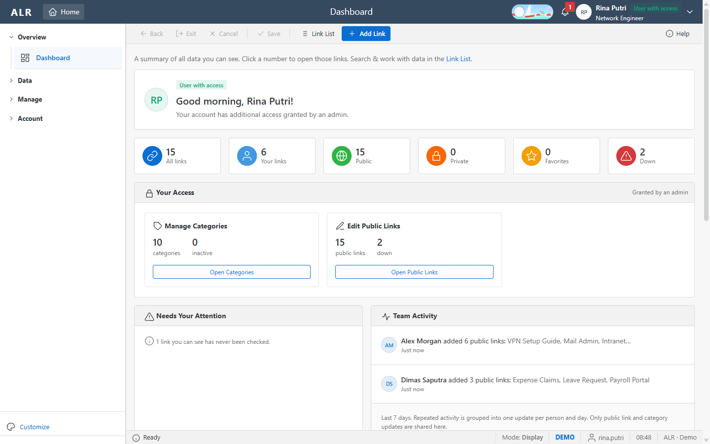
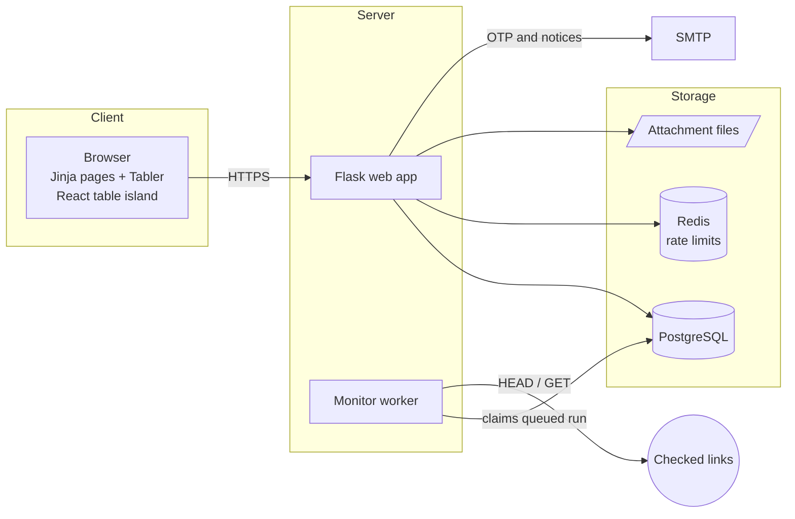
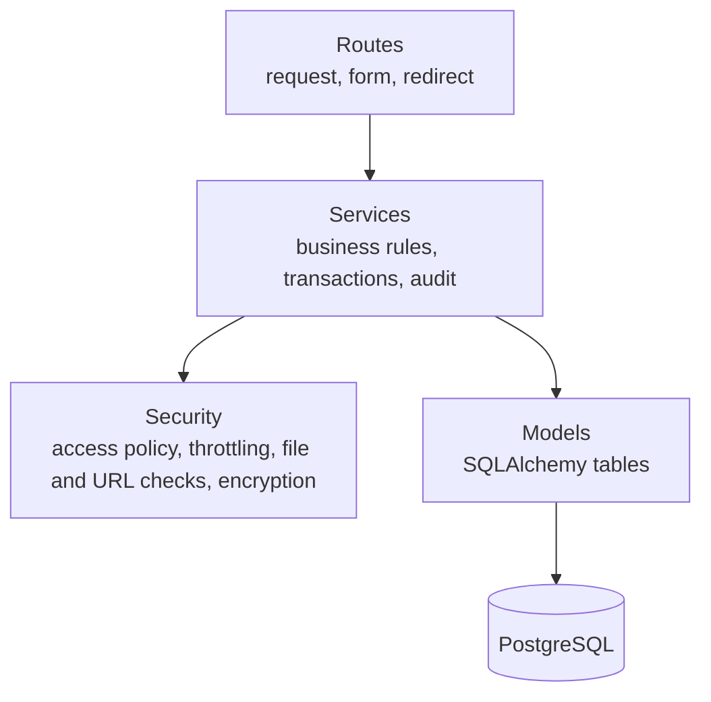
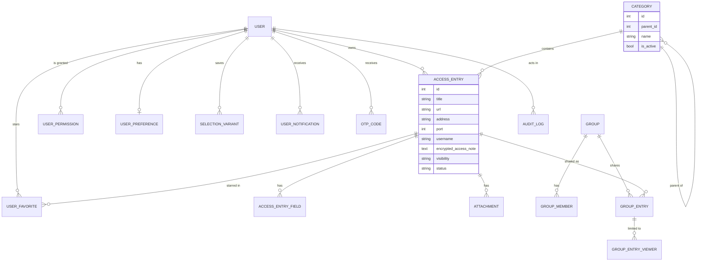
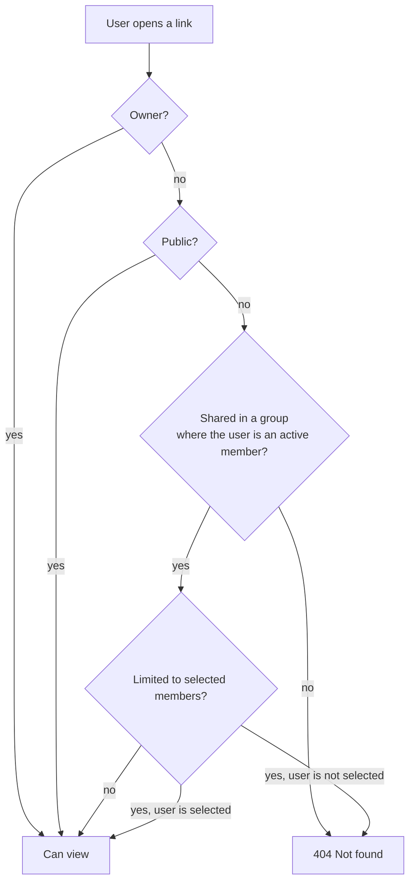
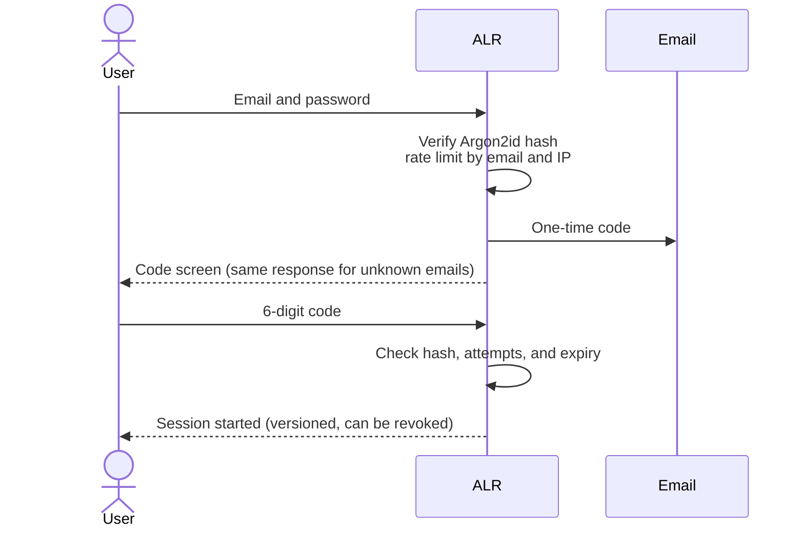
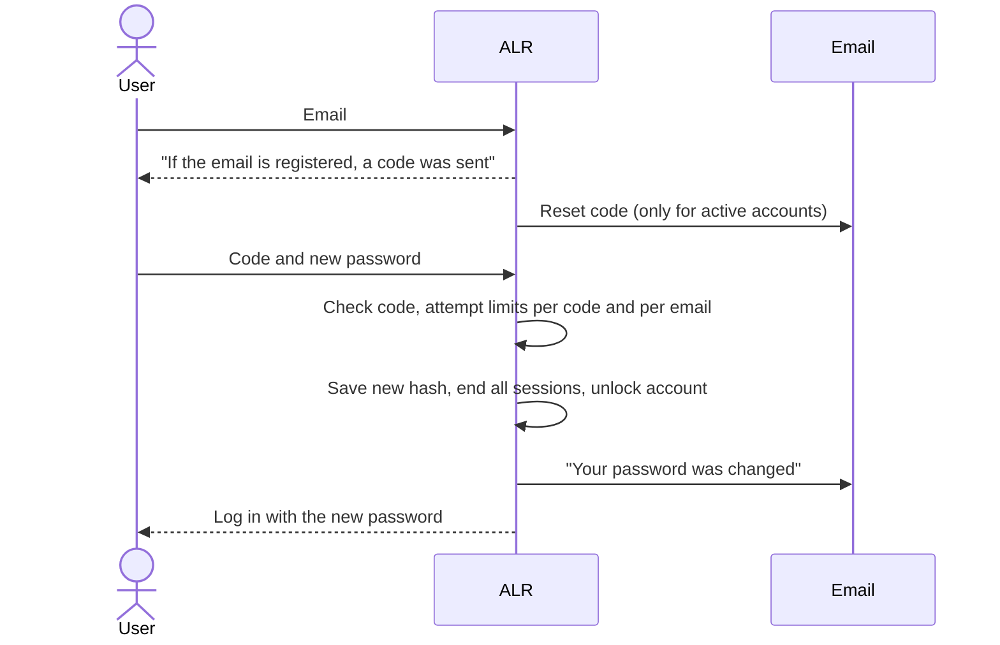
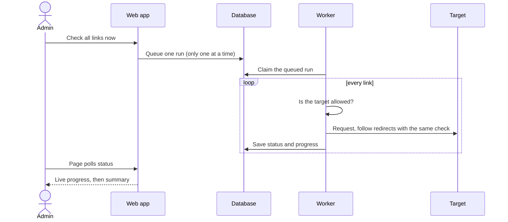
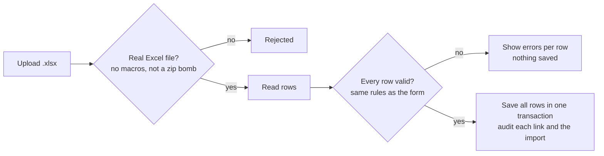

<picture>
  <source media="(prefers-color-scheme: dark)" srcset="assets/banner-dark.svg">
  
</picture>

<h1 align="center">Access Link Register</h1>

<p align="center">
  A web app for an ICT team to store, find, and share the links, servers, and access notes they use every day.<br>
  Encrypted, permission-aware, fully audited, and driven by the keyboard like SAP GUI.
</p>

<p align="center">
  <a href="#screenshots">Screenshots</a> &nbsp;·&nbsp;
  <a href="#features">Features</a> &nbsp;·&nbsp;
  <a href="#roles-and-permissions">Roles</a> &nbsp;·&nbsp;
  <a href="#how-it-works">How it works</a> &nbsp;·&nbsp;
  <a href="#security">Security</a> &nbsp;·&nbsp;
  <a href="#testing">Testing</a> &nbsp;·&nbsp;
  <a href="#running-locally">Run it</a>
</p>

<p align="center">
  
</p>

> [!NOTE]
> Built for an internal team and published as a portfolio project with permission. No company data, credentials, or infrastructure details are included. All screenshots use demo data.

<br>

## At a glance

<div align="center">

| 16 | 67 | 18 | 25 | 770+ |
|:---:|:---:|:---:|:---:|:---:|
| screens | routes | database tables | migrations | automated tests |

</div>

<br>

## Screenshots

Click a group to open it. Images follow your GitHub theme (light or dark).

<details open>
<summary><b>Dashboards</b> &nbsp;·&nbsp; Each role sees a different home screen.</summary>
<br>
<table>
  <tr>
    <td width="50%" valign="top">
      <picture>
        <source media="(prefers-color-scheme: dark)" srcset="assets/dashboard-admin-dark.png">
        
      </picture>
      <p align="center"><b>Admin</b><br><sub>System overview, admin to-do list, full team activity</sub></p>
    </td>
    <td width="50%" valign="top">
      <picture>
        <source media="(prefers-color-scheme: dark)" srcset="assets/dashboard-access-dark.png">
        
      </picture>
      <p align="center"><b>User with access</b><br><sub>Personal counts and one panel per granted permission</sub></p>
    </td>
  </tr>
  <tr>
    <td width="50%" valign="top">
      <picture>
        <source media="(prefers-color-scheme: dark)" srcset="assets/dashboard-entry-dark.png">
        
      </picture>
      <p align="center"><b>User Entry</b><br><sub>Personal counts and a getting-started guide</sub></p>
    </td>
    <td width="50%" valign="top">
      <picture>
        <source media="(prefers-color-scheme: dark)" srcset="assets/login-dark.png">
        
      </picture>
      <p align="center"><b>Login</b><br><sub>Step 1 of 2: password, then a one-time code</sub></p>
    </td>
  </tr>
</table>
</details>

<details>
<summary><b>Working with links</b> &nbsp;·&nbsp; Search, read, add, and import links.</summary>
<br>
<table>
  <tr>
    <td width="50%" valign="top">
      <picture>
        <source media="(prefers-color-scheme: dark)" srcset="assets/links-dark.png">
        
      </picture>
      <p align="center"><b>Link List</b><br><sub>ALV-like table: filters, status, copy buttons, bulk select</sub></p>
    </td>
    <td width="50%" valign="top">
      <picture>
        <source media="(prefers-color-scheme: dark)" srcset="assets/detail-dark.png">
        
      </picture>
      <p align="center"><b>Link Detail</b><br><sub>Masked access note, link status, change history</sub></p>
    </td>
  </tr>
  <tr>
    <td width="50%" valign="top">
      <picture>
        <source media="(prefers-color-scheme: dark)" srcset="assets/form-dark.png">
        
      </picture>
      <p align="center"><b>Add Link</b><br><sub>Cascading category selects and visibility choice</sub></p>
    </td>
    <td width="50%" valign="top">
      <picture>
        <source media="(prefers-color-scheme: dark)" srcset="assets/import-dark.png">
        
      </picture>
      <p align="center"><b>Import from Excel</b><br><sub>Template download and all-or-nothing upload</sub></p>
    </td>
  </tr>
</table>
</details>

<details>
<summary><b>Administration</b> &nbsp;·&nbsp; Screens for admins and users with extra access.</summary>
<br>
<table>
  <tr>
    <td width="50%" valign="top">
      <picture>
        <source media="(prefers-color-scheme: dark)" srcset="assets/users-dark.png">
        
      </picture>
      <p align="center"><b>Users</b><br><sub>Selection screen, status, roles, and actions</sub></p>
    </td>
    <td width="50%" valign="top">
      <picture>
        <source media="(prefers-color-scheme: dark)" srcset="assets/user-access-dark.png">
        
      </picture>
      <p align="center"><b>Change User Access</b><br><sub>Grant or revoke extra permissions</sub></p>
    </td>
  </tr>
  <tr>
    <td width="50%" valign="top">
      <picture>
        <source media="(prefers-color-scheme: dark)" srcset="assets/categories-dark.png">
        
      </picture>
      <p align="center"><b>Categories</b><br><sub>Up to 4 levels, built-in and custom categories</sub></p>
    </td>
    <td width="50%" valign="top">
      <picture>
        <source media="(prefers-color-scheme: dark)" srcset="assets/monitoring-dark.png">
        
      </picture>
      <p align="center"><b>Link Monitoring</b><br><sub>Queue a check and follow its progress</sub></p>
    </td>
  </tr>
</table>
</details>

<details>
<summary><b>Collaboration and account</b> &nbsp;·&nbsp; Audit trail, groups, settings, and help.</summary>
<br>
<table>
  <tr>
    <td width="50%" valign="top">
      <picture>
        <source media="(prefers-color-scheme: dark)" srcset="assets/audit-dark.png">
        
      </picture>
      <p align="center"><b>Audit Logs</b><br><sub>Read-only record of every change, login, and password reveal</sub></p>
    </td>
    <td width="50%" valign="top">
      <picture>
        <source media="(prefers-color-scheme: dark)" srcset="assets/group-dark.png">
        
      </picture>
      <p align="center"><b>Group Detail</b><br><sub>Share selected links with invited members</sub></p>
    </td>
  </tr>
  <tr>
    <td width="50%" valign="top">
      <picture>
        <source media="(prefers-color-scheme: dark)" srcset="assets/settings-dark.png">
        
      </picture>
      <p align="center"><b>Settings</b><br><sub>Edit profile and change password</sub></p>
    </td>
    <td width="50%" valign="top">
      <picture>
        <source media="(prefers-color-scheme: dark)" srcset="assets/help-dark.png">
        
      </picture>
      <p align="center"><b>Help (F1)</b><br><sub>Screen help and the full keyboard shortcut list</sub></p>
    </td>
  </tr>
</table>
</details>

<br>

## Features

Each module below opens to show what it does.

<details>
<summary><b>Links</b> &nbsp;·&nbsp; the core register</summary>
<br>

| Capability | Details |
|---|---|
| Link types | A URL, a host or IP with a port, or a written guide with up to 10 custom fields |
| Categories | Up to 4 levels (for example Web › ERP), picked with cascading selects |
| Visibility | Private (owner only) or Public (everyone can view and copy, read-only) |
| Access note | Password or access hint, encrypted in the database and hidden until revealed |
| Attachments | Up to 5 files per link: images, PDF, Excel, Word, text |
| Favorites | Star a link; filter the list to favorites only |
| History | Who created, changed, or revealed the password of a link, and when |
| Import | Excel template with dropdowns; every row is checked and saved all-or-nothing |
| Export | Excel file of the current search, with a summary sheet |

</details>

<details>
<summary><b>SAP GUI style screens</b> &nbsp;·&nbsp; familiar for ERP users</summary>
<br>

| Element | Details |
|---|---|
| Toolbar | Back, Exit, Cancel, Save, and Help always in the same place; unused buttons are disabled |
| Function keys | Every toolbar button has a key (see [Keyboard shortcuts](#keyboard-shortcuts)) |
| Selection screen | Search criteria with wildcards (`ad*`, `*ad`, `*ad*`) and multiple values per field |
| Variants | Save a set of criteria under a name and load it again later |
| ALV-like table | Sort, filter per column, resize and hide columns (saved per user), active row, right-click menu |
| Status bar | Last message with history, screen mode, environment, user, and clock |

</details>

<details>
<summary><b>Dashboards</b> &nbsp;·&nbsp; different for each role</summary>
<br>

| Role | What the dashboard shows |
|---|---|
| Admin | Users, locked and inactive accounts, link status, last check time, and an admin to-do list |
| User with access | Personal counts plus one work panel for each permission an admin granted |
| User Entry | Personal counts, links that need attention, and a getting-started guide for new users |

All roles also see a **team activity feed**. Repeated actions are grouped into one line per person per day ("Rina added 6 public links"), so the feed does not turn into noise. Only public activity is shown to regular users; account and security events are visible to admins only.

</details>

<details>
<summary><b>Groups</b> &nbsp;·&nbsp; sharing with specific people</summary>
<br>

- Create a group, invite members by email, members accept or decline
- Share your own or public links into the group
- Limit a shared link to selected members only
- The owner decides which members may add links

</details>

<details>
<summary><b>Link monitoring</b> &nbsp;·&nbsp; is it up or down?</summary>
<br>

- An admin starts a check from the web page; a separate worker process does the work
- Progress updates live on the page; results show as Up, Down, or Not checked everywhere in the app
- Every target, including each redirect, is checked against a block list of private, loopback, and cloud metadata addresses

</details>

<details>
<summary><b>Account</b> &nbsp;·&nbsp; sign-in and personal settings</summary>
<br>

- Register with a company email and confirm it with a code
- Two-step login: password, then a one-time code sent by email
- Forgot password, change password, and edit profile
- Notification bell for access changes, blocked logins, and password changes
- Light and dark theme with an animated switch, accent colors, fonts, and compact mode

</details>

<br>

## Roles and permissions

There are two roles. An admin can grant a regular user extra permissions, which gives the "User with access" experience.

<div align="center">

| Action | User Entry | User with access | Admin |
|---|:---:|:---:|:---:|
| Add, edit, and delete own links | ✓ | ✓ | ✓ |
| View and copy public links | ✓ | ✓ | ✓ |
| View other people's private links | – | – | – |
| Create groups and share links | ✓ | ✓ | ✓ |
| Import and export Excel | ✓ | ✓ | ✓ |
| Manage categories | – | if granted | ✓ |
| Edit or delete other people's public links | – | if granted | ✓ |
| View audit logs | – | if granted | ✓ |
| Manage users and grant access | – | – | ✓ |
| Run link monitoring | – | – | ✓ |
| Delete many links at once | – | – | ✓ |

</div>

Private links stay private for everyone, admins included. Admin accounts can only be created from the command line.

<br>

## Keyboard shortcuts

<div align="center">

| Key | Action | Key | Action |
|:---:|---|:---:|---|
| <kbd>F3</kbd> | Back | <kbd>F1</kbd> | Help for this screen |
| <kbd>Shift</kbd> + <kbd>F3</kbd> | Exit to Dashboard | <kbd>/</kbd> | Jump to quick search |
| <kbd>F12</kbd> | Cancel changes | <kbd>↑</kbd> <kbd>↓</kbd> | Move the active table row |
| <kbd>Ctrl</kbd> + <kbd>S</kbd> | Save | <kbd>Enter</kbd> | Open the active row |
| <kbd>F8</kbd> | Execute search | <kbd>Shift</kbd> + <kbd>F10</kbd> | Row menu |
| <kbd>Shift</kbd> + <kbd>F2</kbd> | Delete | <kbd>Esc</kbd> | Close dialog or menu |

</div>

<br>

## How it works

Each diagram opens on click. GitHub renders them, and you can zoom and pan.

<details>
<summary><b>Architecture</b></summary>
<br>



The web app and the worker are separate processes that only talk through the database, so a long check never blocks a web request.

</details>

<details>
<summary><b>Code layers</b></summary>
<br>



| Folder | Job |
|---|---|
| `app/routes/` | HTTP in and out. No business rules here. |
| `app/services/` | Business rules, one transaction per action, audit logging |
| `app/security/` | Access policy, rate limiting, upload checks, link target checks, encryption |
| `app/models/` | Tables and constraints; schema changes go through Alembic migrations |
| `app/schemas/` | Form and selection screen definitions |
| `frontend/` | React 19 + Vite source for the link table, built into `app/static/dist` |

</details>

<details>
<summary><b>Data model</b></summary>
<br>



Categories use one self-referencing table (`parent_id`). Users can add sub-categories at any level without a schema change.

</details>

<details>
<summary><b>Who can see a link</b></summary>
<br>



The same rule is a single SQL filter used by every list, count, search, export, and detail page, so they can never disagree. A hidden link returns 404, so its existence is not revealed.

</details>

<details>
<summary><b>Login</b></summary>
<br>



</details>

<details>
<summary><b>Forgot password</b></summary>
<br>



Reset codes and login codes are stored separately, so one can never be used as the other.

</details>

<details>
<summary><b>Link monitoring</b></summary>
<br>



</details>

<details>
<summary><b>Excel import</b></summary>
<br>



</details>

<br>

## Security

<div align="center">

| Risk | How ALR handles it |
|---|---|
| Database leak | Access notes encrypted with Fernet (AES); passwords hashed with Argon2id; one-time codes stored as hashes |
| Finding out which emails exist | Login, registration, and password reset respond the same way for known and unknown emails |
| Password guessing | Rate limits per IP and per email, temporary lockout, attempt limits per code |
| Stolen session | Sessions carry a version; a password change or reset ends every other session |
| Seeing private data | One shared visibility filter for every query; hidden data returns 404 |
| "Who opened the password?" | Access notes are not in the page HTML; each reveal is a separate request written to the audit log |
| XSS | Input sanitizing and a Content Security Policy that only allows the app's own scripts |
| CSRF | Tokens on every form and every JSON call |
| Malicious uploads | File signature checks, macro and zip bomb checks, XXE-safe Excel parsing |
| SSRF through the link checker | Private, loopback, and metadata addresses blocked, including after redirects and for IPv6 |
| Two people changing the same thing | Row locks on critical updates, tested on PostgreSQL with parallel requests |
| Changing history | Audit log rows cannot be updated or deleted through the app |

</div>

<br>

## Engineering decisions

<details>
<summary><b>Why one table for categories?</b></summary>
<br>

Users add their own sub-categories, so the depth is not fixed. One self-referencing table (`parent_id`) handles any level with the same queries. Depth is capped at 4 in the service layer, and the full tree is small enough to load once per request and build in memory.

</details>

<details>
<summary><b>Why a React "island" instead of a full single-page app?</b></summary>
<br>

Most screens are forms and lists that work well as server-rendered pages. Only the link table needs rich client behavior (column layout, active row, right-click menu, live filtering), so only that part is React. The built files are committed, so running the app does not need Node.js.

</details>

<details>
<summary><b>Why is the visibility rule one SQL filter?</b></summary>
<br>

When lists, counts, exports, and detail pages each check access their own way, they drift apart and leak data. One filter function is used by all of them, and tests check that a private link never shows up anywhere for another user.

</details>

<details>
<summary><b>Why does the link checker run in a separate worker?</b></summary>
<br>

Checking hundreds of links takes minutes. Running it inside a web request would hit timeouts and block a web worker. The page only queues a run in the database; the worker claims it, saves progress, and can recover a run that was interrupted.

</details>

<details>
<summary><b>Why is the access note fetched on demand?</b></summary>
<br>

If the password is in the page HTML, anyone who opens the page has it, and there is no record of who looked. Fetching it only when someone clicks Show or Copy keeps it out of the page and makes every reveal visible in the audit log and the link history.

</details>

<br>

## Testing

<div align="center">

| Suite | Tool | Count | What it covers |
|---|---|:---:|---|
| Backend | pytest | 718 | Services, routes, permissions, and security cases |
| Database concurrency | pytest on PostgreSQL | 6 | Parallel requests, row locks, unique constraints |
| Frontend | Vitest, Testing Library | 46 | React table, columns, selection, keyboard |
| End to end | Headless Chrome | 8 scenarios | Login, tables, accounts, categories, groups, monitoring, SAP keys |

</div>

Every feature is tested for the normal flow and for misuse: the wrong role, another user's private data, invalid input, and repeated submits. A CI pipeline runs the backend, PostgreSQL, and frontend suites, plus secret detection, on every push.

<br>

## Project structure

<details>
<summary><b>Show folder tree</b></summary>
<br>

```text
.
├── app/
│   ├── models/         SQLAlchemy models (18 tables)
│   ├── routes/         Blueprints: auth, entries, categories, groups, users, audit, monitoring, settings
│   ├── schemas/        Forms and selection screen definitions
│   ├── security/       Access policy, throttling, file and URL checks, encryption
│   ├── services/       Business rules, import/export, link checking, notifications
│   ├── static/         CSS, JavaScript, built React table (dist/)
│   ├── templates/      Jinja layouts, components, and pages
│   ├── utils/          Constants and small helpers
│   ├── cli.py          Admin and maintenance commands
│   └── config.py       Settings per environment
├── frontend/           React 19 + Vite source for the link table
├── migrations/         Alembic migrations
├── scripts/e2e/        End-to-end scenarios (headless Chrome)
├── tests/              pytest suites
└── run.py              App entry point
```

</details>

<br>

## Running locally

<details>
<summary><b>Setup steps</b></summary>
<br>

Requires Python 3.13 and PostgreSQL 17. Node.js 24 is only needed to change the React table.

```bash
python -m venv .venv
# Windows: .venv\Scripts\activate
# macOS/Linux: source .venv/bin/activate
pip install -r requirements-dev.txt

cp .env.example .env
# Set SECRET_KEY, DATABASE_URL, and ENCRYPTION_KEY. To create an encryption key:
python -c "from cryptography.fernet import Fernet; print(Fernet.generate_key().decode())"

flask --app run db upgrade
flask --app run seed-categories
flask --app run create-admin
flask --app run run
```

</details>

<details>
<summary><b>Command line tools</b></summary>
<br>

| Command | Purpose |
|---|---|
| `create-admin` | Create the first admin account |
| `set-admin` / `unset-admin` | Promote or demote an account |
| `seed-categories` | Add the built-in categories |
| `monitor-worker` | Run the link monitoring worker (long-running) |
| `check-links` | Run one link check in the terminal |
| `recover-link-monitor` | Recover an interrupted check |
| `cleanup-attachments` | Find and remove orphaned attachment files |
| `cleanup-old-data` | Remove expired codes and old records |

Run each as `flask --app run <command>`.

</details>

<details>
<summary><b>Running the tests</b></summary>
<br>

```bash
pytest -q                          # backend
cd frontend && npm ci && npm test  # React table
node scripts/e2e/table.mjs         # one end-to-end scenario (needs Chrome)
```

</details>

<br>

## Author

**Mochammad Bisma Prasetya** &nbsp;·&nbsp; [github.com/Masbismaa](https://github.com/Masbismaa)
