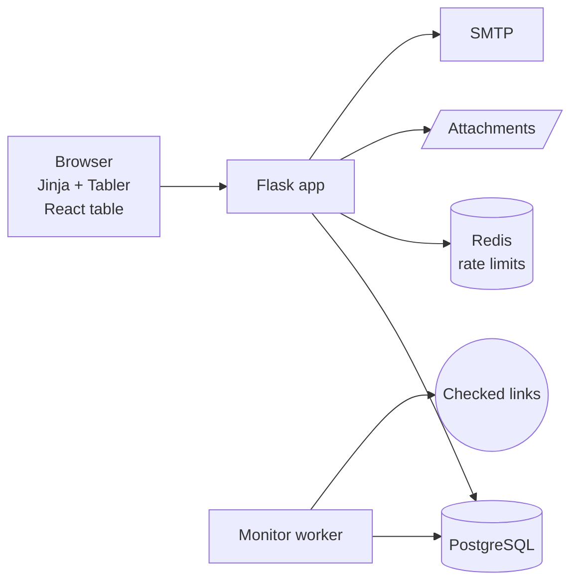
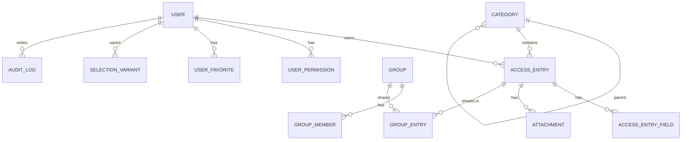
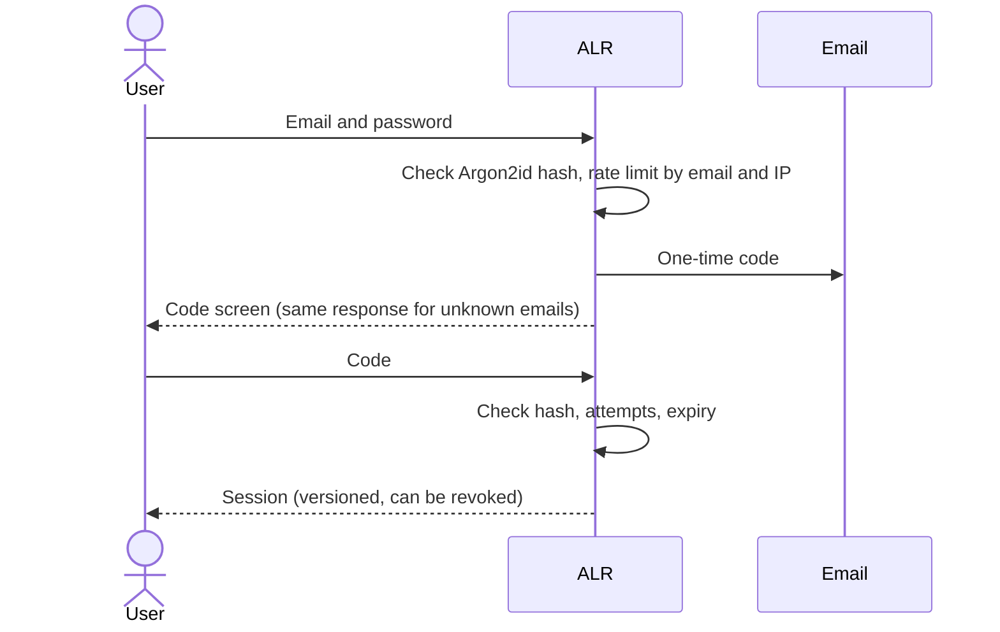

# Access Link Register (ALR)

Web app for an ICT team to store and share links, servers, and access notes. Built with Flask, PostgreSQL, and a small React table, with a keyboard-driven interface modeled on SAP GUI.


> [!NOTE]
> Built for an internal team and published as a portfolio project with permission. No company data, credentials, or infrastructure details are included.

## Contents

- [Features](#features)
- [Architecture](#architecture)
- [Security](#security)
- [Testing](#testing)
- [Running locally](#running-locally)

## Features

<details open>
<summary><b>Links</b></summary>

- A link can be a URL, a host or IP with a port, or a written guide with up to 10 custom fields
- Nested categories, up to 4 levels, picked with cascading selects
- Private (owner only) or Public (everyone, read-only)
- Attachments, favorites, per-link change history, copy buttons
- Excel import from a generated template, and Excel export
</details>

<details>
<summary><b>SAP GUI style screens</b></summary>

- Fixed toolbar with function keys: <kbd>F3</kbd> Back, <kbd>Shift</kbd>+<kbd>F3</kbd> Exit, <kbd>F12</kbd> Cancel, <kbd>Ctrl</kbd>+<kbd>S</kbd> Save, <kbd>F8</kbd> Execute, <kbd>Shift</kbd>+<kbd>F2</kbd> Delete, <kbd>F1</kbd> Help
- Selection screen with wildcards (`ad*`, `*ad*`), multiple values, and saved variants
- ALV-like table: sort, filter, resize and hide columns (saved per user), active row, right-click menu
- Status bar with message history, current user, and clock
</details>

<details>
<summary><b>Roles and teams</b></summary>

Three roles, each with its own dashboard:

| Role | Dashboard |
|---|---|
| Admin | System overview (users, locked accounts, link status) and an admin to-do list |
| User with access | Personal counts and one panel for each permission granted by an admin |
| User Entry | Personal counts and a getting-started guide |

- Groups for sharing links with specific people
- Team activity feed, grouped per person per day; account and security events are visible to admins only
- Admin tools: bulk delete, lock and unlock, deactivate, delete account (personal data anonymized, public links kept)
</details>

<details>
<summary><b>Link monitoring</b></summary>

An admin starts a check from the web page. A separate worker process checks each link and the page shows progress as it runs. Requests to private, loopback, and cloud metadata addresses are blocked, including after redirects.
</details>

<details>
<summary><b>Account</b></summary>

- Registration with email verification
- Login with password and a one-time code sent by email
- Forgot password, change password, edit profile
- Light and dark theme, accent color, font, compact mode
</details>

## Architecture



| Folder | Purpose |
|---|---|
| `app/routes/` | Requests, forms, redirects |
| `app/services/` | Business rules, transactions, audit log |
| `app/security/` | Access policy, rate limiting, file checks, link target checks, encryption |
| `app/models/` | SQLAlchemy models, Alembic migrations |
| `frontend/` | React 19 + Vite table, built into `app/static/dist` |

<details>
<summary><b>Data model (simplified)</b></summary>



Categories are one self-referencing table (`parent_id`), so users can add sub-categories without schema changes.
</details>

<details>
<summary><b>Login flow</b></summary>


</details>

## Security

| Risk | Handling |
|---|---|
| Database leak | Access notes encrypted with Fernet; passwords hashed with Argon2id; one-time codes stored as hashes |
| Finding out which emails exist | Login, registration, and password reset respond the same way for known and unknown emails |
| Password guessing | Rate limits per IP and per email, temporary lockout, attempt limits per code |
| Stolen session | Changing or resetting a password ends all other sessions |
| Seeing private data | One shared visibility filter for every query; private data returns 404 |
| Password access | Access notes are not in the page HTML; each reveal is a separate request and is written to the audit log |
| XSS and CSRF | Input sanitizing, Content Security Policy, CSRF tokens on forms and API calls |
| Uploaded files | Content type detection, macro and zip bomb checks, XXE-safe Excel parsing |
| Concurrent edits | Row locks on critical updates, tested against PostgreSQL |
| Audit log tampering | Audit rows cannot be updated |

## Testing

| Suite | Tool |
|---|---|
| Backend, 700+ tests | pytest |
| PostgreSQL concurrency | pytest |
| React table | Vitest, Testing Library |
| End to end | Headless Chrome |

Tests cover both the normal flow and misuse: wrong role, another user's private data, invalid input, repeated submits.

## Running locally

<details>
<summary><b>Steps</b></summary>

Requires Python 3.13 and PostgreSQL 17. Node.js 24 is only needed to change the React table.

```bash
python -m venv .venv
# Windows: .venv\Scripts\activate
# macOS/Linux: source .venv/bin/activate
pip install -r requirements-dev.txt

cp .env.example .env
# Set SECRET_KEY, DATABASE_URL, ENCRYPTION_KEY. To make an encryption key:
python -c "from cryptography.fernet import Fernet; print(Fernet.generate_key().decode())"

flask --app run db upgrade
flask --app run seed-categories
flask --app run create-admin
flask --app run run
```

Tests:

```bash
pytest -q
cd frontend && npm ci && npm test
```
</details>

## Author

Mochammad Bisma Prasetya ([@Masbismaa](https://github.com/Masbismaa))
