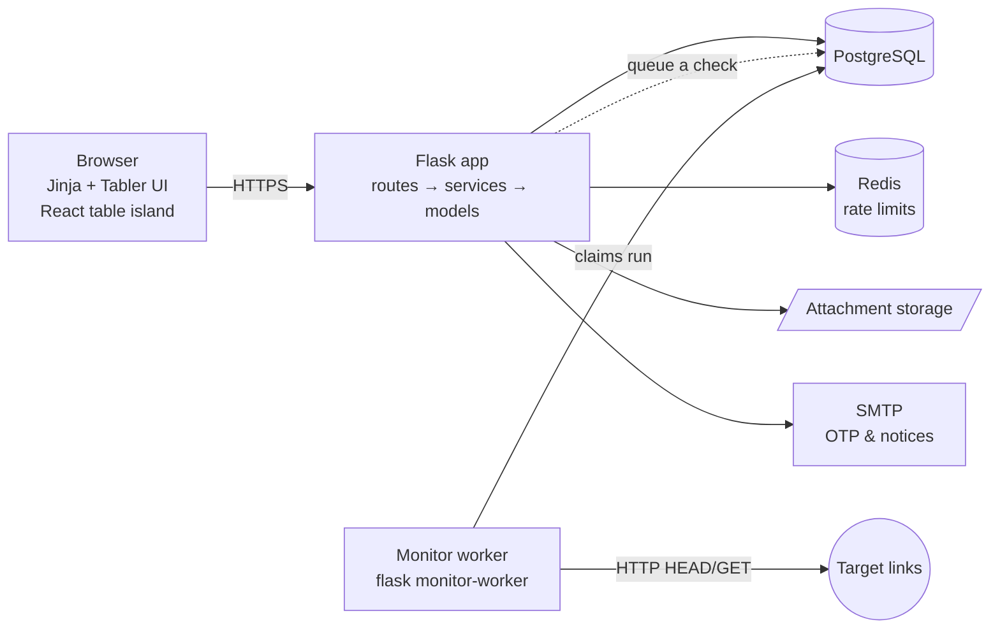
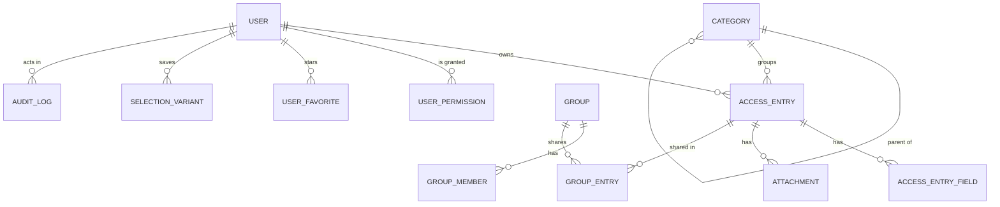
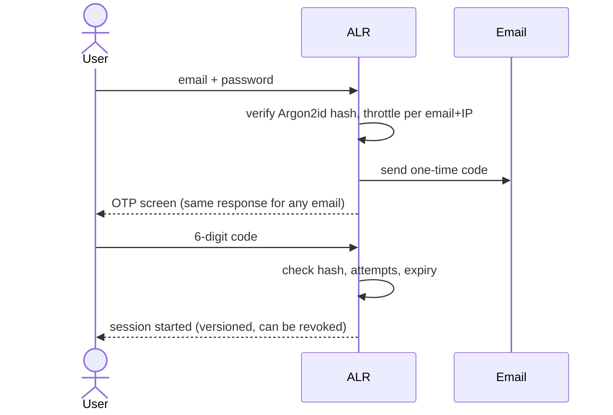

<div align="center">

# 🔐 Access Link Register (ALR)

**A secure, SAP‑style web app for an ICT team to store and share the links, servers, and access notes they use every day.**


[Features](#-features) · [Architecture](#-architecture) · [Security](#-security-by-design) · [Testing](#-testing) · [Run it locally](#-run-it-locally)

</div>

> [!NOTE]
> This project was built for an internal ICT team and is published here **as a portfolio piece with permission**.
> It contains no company data, credentials, or infrastructure details. Everything shown uses demo values.

---

## 💡 The problem

An ICT team keeps hundreds of links: web portals, ERP screens, servers, network devices, and the notes needed to reach them.
Before ALR, this lived in spreadsheets and chat messages. Nobody knew which copy was current, passwords were shared in plain text, and there was no record of who looked at what.

**ALR gives the team one place for all of it**: searchable, encrypted, permission‑aware, and fully audited.

---

## ✨ Features

<details open>
<summary><b>🔗 Link register</b></summary>

- Store a link as a URL, a host/IP with a port, or a free‑form guide with up to 10 custom fields
- **Nested categories** (up to 4 levels) chosen with cascading selects
- **Private** (only you) or **Public** (whole team, read‑only) visibility
- Attachments with real content‑type checks
- ⭐ Favorites, per‑link change **history**, and one‑click copy buttons
- **Excel import** from a generated template (all‑or‑nothing, with row‑by‑row errors) and **Excel export**
</details>

<details>
<summary><b>🖥️ SAP GUI–style workflow</b></summary>

- Fixed toolbar with function keys: <kbd>F3</kbd> Back · <kbd>Shift</kbd>+<kbd>F3</kbd> Exit · <kbd>F12</kbd> Cancel · <kbd>Ctrl</kbd>+<kbd>S</kbd> Save · <kbd>F8</kbd> Execute · <kbd>Shift</kbd>+<kbd>F2</kbd> Delete · <kbd>F1</kbd> Help
- **Selection screen** with wildcards (`ad*`, `*ad*`), multi‑value ranges, and saved **variants**
- **ALV‑like table** (React): sort, filter, resize/hide columns (layout saved per user), active row, right‑click menu, keyboard navigation
- Status bar with message history, current user, and clock
</details>

<details>
<summary><b>👥 Teams & roles</b></summary>

- Three experiences: **Admin**, **User with access** (extra permissions granted by an admin), and **User Entry**
- Each role gets its **own dashboard**:

  | Role | Dashboard |
  |---|---|
  | Admin | System overview (users, locked accounts, link health) + admin to‑do list |
  | User with access | Personal numbers + one work panel per granted permission |
  | User Entry | Personal numbers + a "get started" guide |

- **Groups** for sharing links with specific people, with invitations
- **Team activity feed** grouped to avoid spam ("Alex added 5 public links"); sensitive events are admin‑only
- Admin bulk delete, user lock/unlock, deactivate, and safe account deletion (anonymized, public links kept)
</details>

<details>
<summary><b>📡 Link monitoring</b></summary>

- Admin starts a health check; a **background worker** checks every link and reports progress live
- Protected against SSRF (blocks private, loopback, and cloud‑metadata targets, including IPv6)
- Up / Down / Unknown status shown across the app
</details>

<details>
<summary><b>👤 Account</b></summary>

- Register with email verification, log in with **password + one‑time code (OTP)**
- Forgot password, change password (logs out all other sessions), edit profile
- Light/dark theme with an animated day/night switch, accent color, font, and compact mode
</details>

---

## 🏗️ Architecture



The code follows a simple layered structure, so each part has one job:

| Layer | Folder | Job |
|---|---|---|
| Routes | `app/routes/` | HTTP in/out, forms, redirects |
| Services | `app/services/` | Business rules, transactions, audit logging |
| Security | `app/security/` | Access policy, throttling, file validation, SSRF guard, encryption |
| Models | `app/models/` | SQLAlchemy tables (migrations with Alembic) |
| Frontend | `frontend/` | React 19 + Vite link table, built into `app/static/dist` |

<details>
<summary><b>🗂️ Data model (simplified)</b></summary>



Categories use a single self‑referencing table (adjacency list), so users can add sub‑categories at any level without schema changes.
</details>

<details>
<summary><b>🔑 Login flow</b></summary>


</details>

---

## 🛡️ Security by design

Security was a first‑class requirement, not an afterthought. Highlights:

| Threat | What ALR does |
|---|---|
| Stolen database | Access notes encrypted at rest (Fernet / AES); passwords hashed with **Argon2id**; OTPs stored as hashes |
| Account enumeration | Login, register, and forgot‑password give identical responses for known and unknown emails |
| Brute force | Rate limits per IP and per email, temporary lockout, attempt limits per code |
| Session theft | Session versioning: password change or reset logs out every other session |
| Over‑sharing | One central visibility filter for every query; private data returns 404, not 403 |
| "Who saw the password?" | Access notes are never in the page HTML; each reveal is fetched on demand and **audited** |
| XSS / CSRF | Input sanitizing, strict Content‑Security‑Policy, CSRF tokens on every form and API call |
| Malicious uploads | Real content‑type detection, macro and zip‑bomb checks, XXE‑safe Excel parsing |
| SSRF via link checker | Private, loopback, and metadata addresses blocked, including after redirects |
| Race conditions | Row locks on critical updates, verified with PostgreSQL concurrency tests |
| Tampering with history | Audit log rows are append‑only (updates are blocked at the model level) |

---

## 🧪 Testing

| Suite | Tool | What it covers |
|---|---|---|
| **700+ backend tests** | pytest | Services, routes, permissions, security cases (positive and negative) |
| PostgreSQL integration | pytest | Real concurrency and locking behavior |
| Frontend unit tests | Vitest + Testing Library | React table, columns, selection, keyboard |
| End‑to‑end | Headless Chrome (CDP) | Login, tables, accounts, categories, monitoring, SAP keys |

Every feature ships with tests for the happy path **and** for abuse: wrong role, someone else's private data, bad input, and double submits.

---

## 🚀 Run it locally

<details>
<summary><b>Show steps</b></summary>

**Requirements:** Python 3.13, PostgreSQL 17. Node.js 24 is only needed to change the React table.

```bash
python -m venv .venv
# Windows: .venv\Scripts\activate   ·   macOS/Linux: source .venv/bin/activate
pip install -r requirements-dev.txt

cp .env.example .env
# Fill in SECRET_KEY, DATABASE_URL, ENCRYPTION_KEY with your own values.
# New encryption key:
python -c "from cryptography.fernet import Fernet; print(Fernet.generate_key().decode())"

flask --app run db upgrade
flask --app run seed-categories
flask --app run create-admin
flask --app run run
```

Run the tests:

```bash
pytest -q
cd frontend && npm ci && npm test
```
</details>

---

<div align="center">

**Built with care by [Mochammad Bisma Prasetya](https://github.com/Masbismaa)**

</div>
