<p align="center">
  <a href="README.md"></a>
  <a href=".github/README.id.md"></a>
</p>

<picture>
  <source media="(prefers-color-scheme: dark)" srcset=".github/assets/banner-dark.svg">
  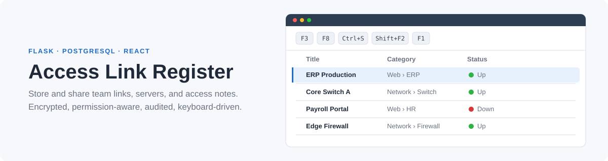
</picture>

<h1 align="center">Access Link Register</h1>

<p align="center">
  A secure internal web application for managing and sharing access information across an ICT team.<br>
  Encrypted at rest, permission-aware, fully audited, and built for keyboard-driven workflows inspired by SAP GUI.
</p>

<p align="center">
  <a href="#overview">Overview</a> &nbsp;·&nbsp;
  <a href="#screenshots">Screenshots</a> &nbsp;·&nbsp;
  <a href="#features">Features</a> &nbsp;·&nbsp;
  <a href="#access-control">Access Control</a> &nbsp;·&nbsp;
  <a href="#architecture">Architecture</a> &nbsp;·&nbsp;
  <a href="#security">Security</a> &nbsp;·&nbsp;
  <a href="#quality-assurance">Quality</a> &nbsp;·&nbsp;
  <a href="#getting-started">Getting Started</a>
</p>

<p align="center">
  
</p>

> [!NOTE]
> This system was developed for internal use and is published as a portfolio project with the organization's permission. The repository contains no organizational data, credentials, or infrastructure details. All screenshots use synthetic demo data.

<br>

## Overview

Access Link Register (ALR) is the single source of truth for the access information an ICT team relies on daily: application URLs, server and network device addresses, and the access hints or instructions required to reach them.

The application is designed around three principles:

| Principle | Implementation |
|---|---|
| **Confidentiality** | Access notes are encrypted at rest, never embedded in page markup, and revealed only on explicit request |
| **Accountability** | Every change, sign-in, and export is recorded in an append-only audit log |
| **Efficiency** | SAP GUI conventions (function keys, selection screens, variants, ALV tables) for users who work in ERP systems every day |

<div align="center">

| 16 | 67 | 17 | 27 | 780+ |
|:---:|:---:|:---:|:---:|:---:|
| screens | HTTP endpoints | database tables | schema migrations | automated tests |

</div>

### Technology Stack

| Layer | Technology |
|---|---|
| Backend | Python 3.13, Flask 3.1, SQLAlchemy 2.0, Alembic |
| Database | PostgreSQL 17 |
| Frontend | Jinja templates, Tabler UI, React 19 island built with Vite |
| Security | Argon2id, Fernet (AES), Flask-WTF CSRF, Flask-Limiter with Redis, nh3 sanitizer |
| Documents | openpyxl with defusedxml for Excel import and export |
| Testing | pytest, Vitest, Testing Library, headless Chrome via the DevTools Protocol |

<br>

## Screenshots

Select a group to expand it. Images adapt to the active GitHub theme.

<details open>
<summary><b>Dashboards</b> &nbsp;·&nbsp; A dedicated home screen for each role.</summary>
<br>
<table>
  <tr>
    <td width="50%" valign="top">
      <picture>
        <source media="(prefers-color-scheme: dark)" srcset=".github/assets/dashboard-admin-dark.png">
        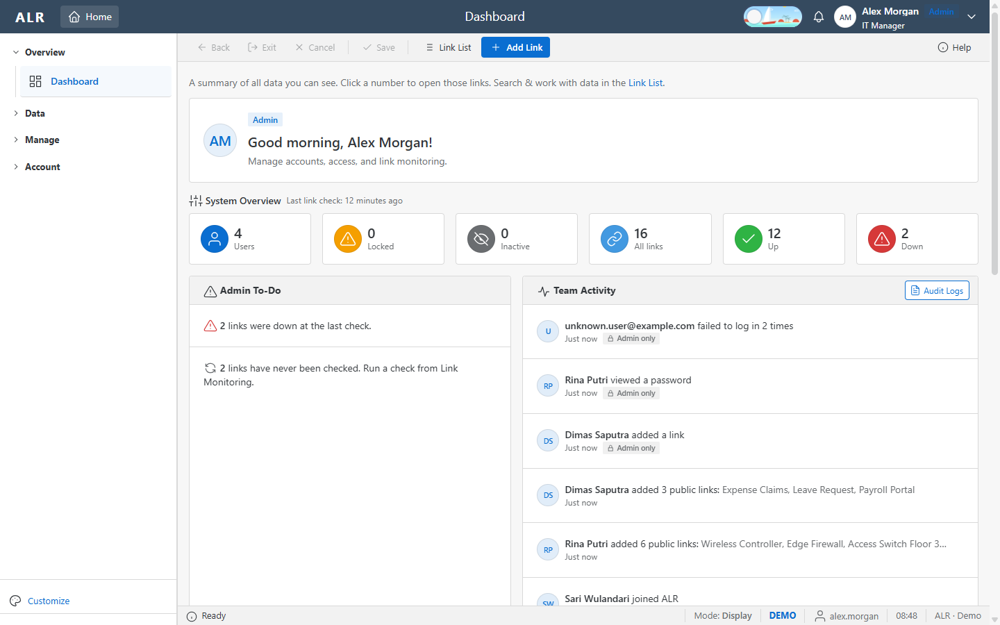
      </picture>
      <p align="center"><b>Administrator</b><br><sub>System overview, administrative tasks, and complete team activity</sub></p>
    </td>
    <td width="50%" valign="top">
      <picture>
        <source media="(prefers-color-scheme: dark)" srcset=".github/assets/dashboard-entry-dark.png">
        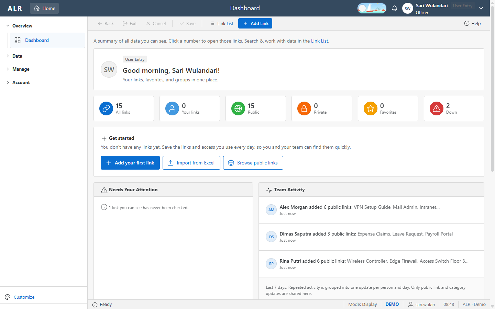
      </picture>
      <p align="center"><b>User Entry</b><br><sub>Personal metrics and an onboarding guide</sub></p>
    </td>
  </tr>
  <tr>
    <td width="50%" valign="top">
      <picture>
        <source media="(prefers-color-scheme: dark)" srcset=".github/assets/login-dark.png">
        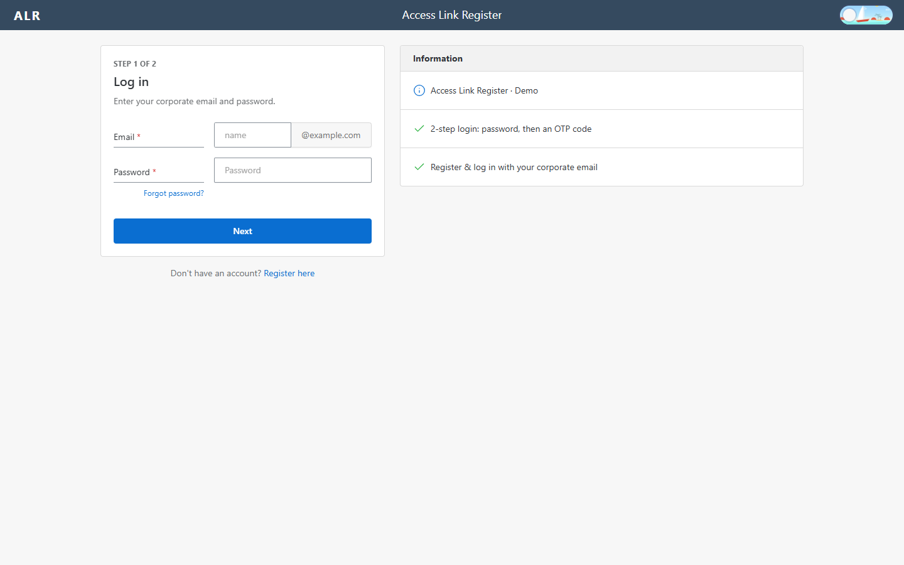
      </picture>
      <p align="center"><b>Sign In</b><br><sub>Step 1 of 2: password verification before the one-time code</sub></p>
    </td>
  </tr>
</table>
</details>

<details>
<summary><b>Link Management</b> &nbsp;·&nbsp; Search, review, create, and import records.</summary>
<br>
<table>
  <tr>
    <td width="50%" valign="top">
      <picture>
        <source media="(prefers-color-scheme: dark)" srcset=".github/assets/links-dark.png">
        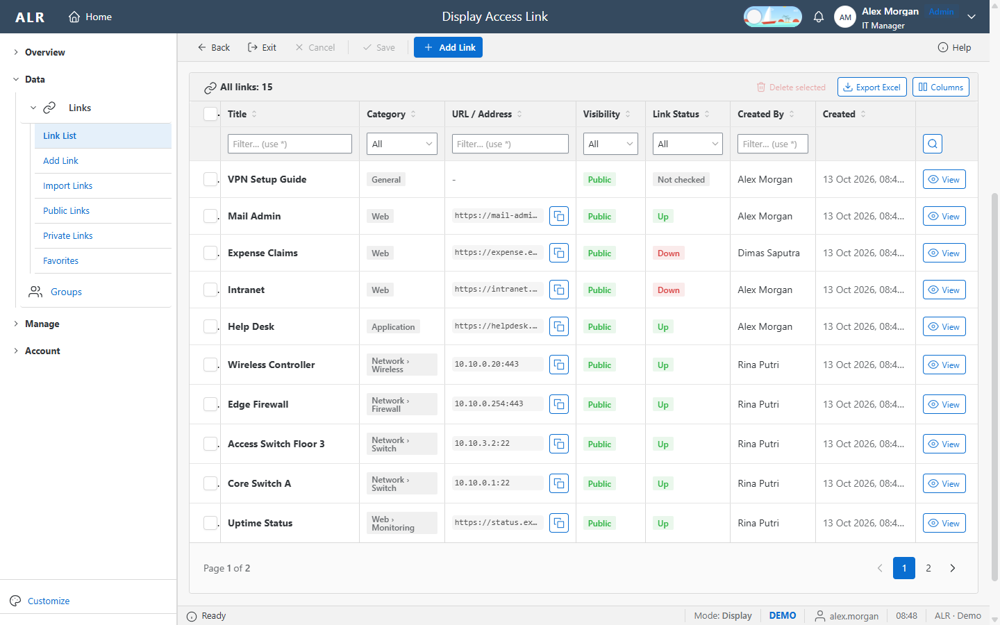
      </picture>
      <p align="center"><b>Link List</b><br><sub>ALV-style table with filters, status, copy actions, and bulk selection</sub></p>
    </td>
    <td width="50%" valign="top">
      <picture>
        <source media="(prefers-color-scheme: dark)" srcset=".github/assets/detail-dark.png">
        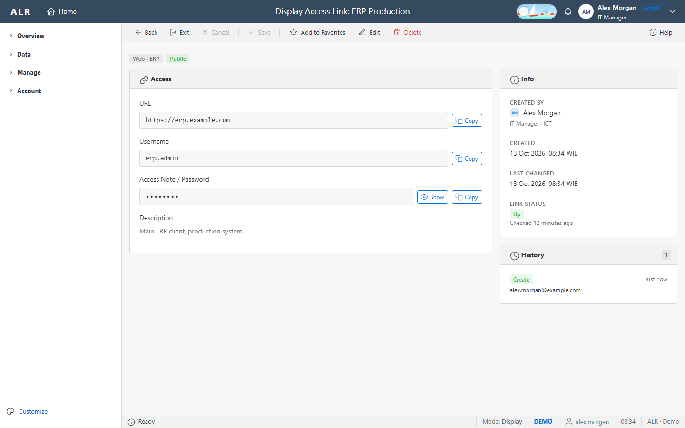
      </picture>
      <p align="center"><b>Link Detail</b><br><sub>Masked access note, availability status, and change history</sub></p>
    </td>
  </tr>
  <tr>
    <td width="50%" valign="top">
      <picture>
        <source media="(prefers-color-scheme: dark)" srcset=".github/assets/form-dark.png">
        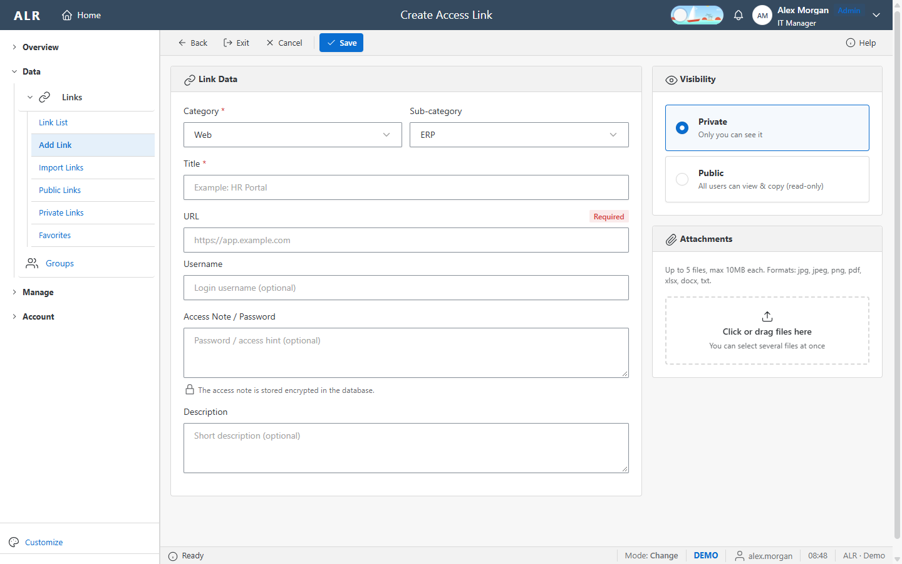
      </picture>
      <p align="center"><b>Create Link</b><br><sub>Cascading category selection and visibility settings</sub></p>
    </td>
    <td width="50%" valign="top">
      <picture>
        <source media="(prefers-color-scheme: dark)" srcset=".github/assets/import-dark.png">
        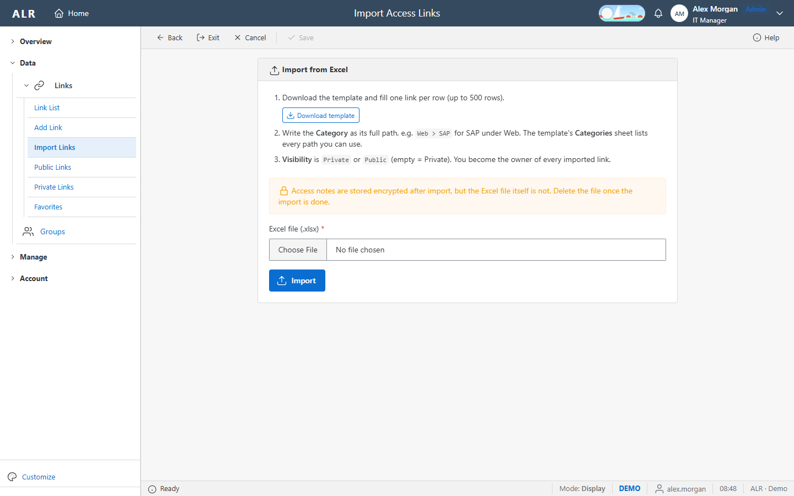
      </picture>
      <p align="center"><b>Excel Import</b><br><sub>Template download and transactional upload</sub></p>
    </td>
  </tr>
</table>
</details>

<details>
<summary><b>Administration</b> &nbsp;·&nbsp; Screens for administrators.</summary>
<br>
<table>
  <tr>
    <td width="50%" valign="top">
      <picture>
        <source media="(prefers-color-scheme: dark)" srcset=".github/assets/users-dark.png">
        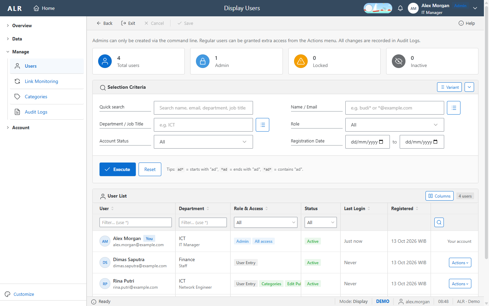
      </picture>
      <p align="center"><b>User Management</b><br><sub>Selection screen, account status, roles, and actions</sub></p>
    </td>
    <td width="50%" valign="top">
      <picture>
        <source media="(prefers-color-scheme: dark)" srcset=".github/assets/categories-dark.png">
        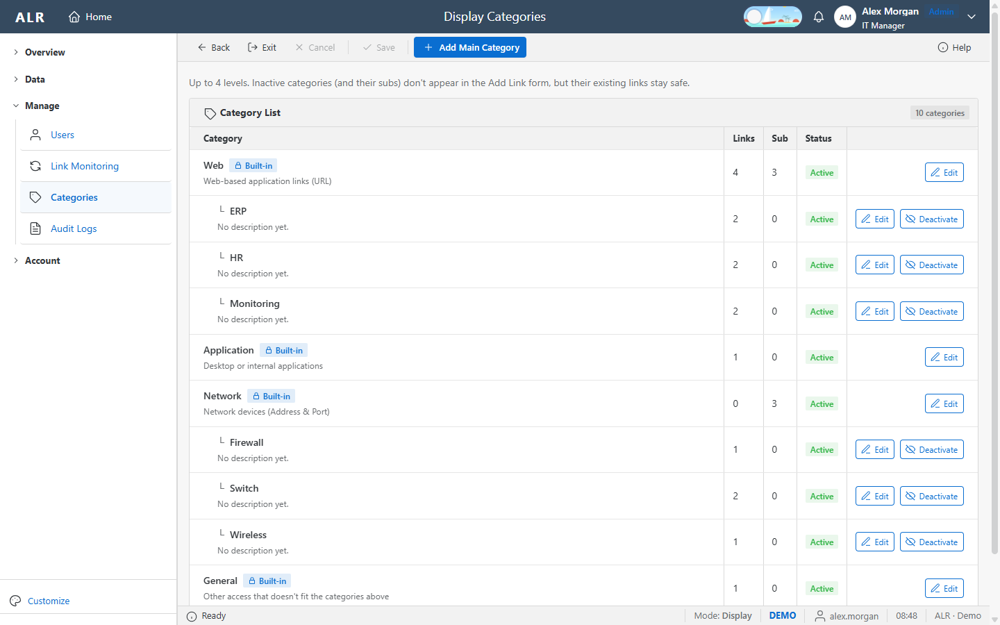
      </picture>
      <p align="center"><b>Category Management</b><br><sub>Up to four levels with built-in and custom categories</sub></p>
    </td>
  </tr>
  <tr>
    <td width="50%" valign="top">
      <picture>
        <source media="(prefers-color-scheme: dark)" srcset=".github/assets/monitoring-dark.png">
        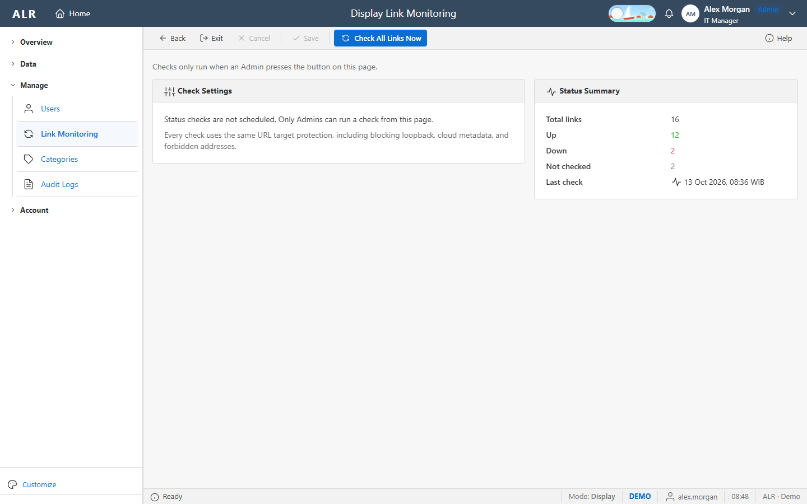
      </picture>
      <p align="center"><b>Link Monitoring</b><br><sub>Queue an availability check and track its progress</sub></p>
    </td>
  </tr>
</table>
</details>

<details>
<summary><b>Collaboration and Account</b> &nbsp;·&nbsp; Audit trail, groups, settings, and help.</summary>
<br>
<table>
  <tr>
    <td width="50%" valign="top">
      <picture>
        <source media="(prefers-color-scheme: dark)" srcset=".github/assets/audit-dark.png">
        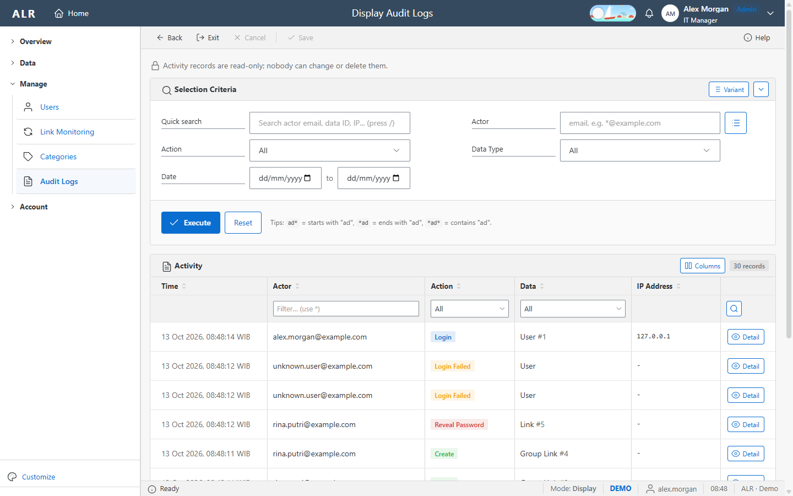
      </picture>
      <p align="center"><b>Audit Logs</b><br><sub>Immutable record of changes, sign-ins, and exports</sub></p>
    </td>
    <td width="50%" valign="top">
      <picture>
        <source media="(prefers-color-scheme: dark)" srcset=".github/assets/group-dark.png">
        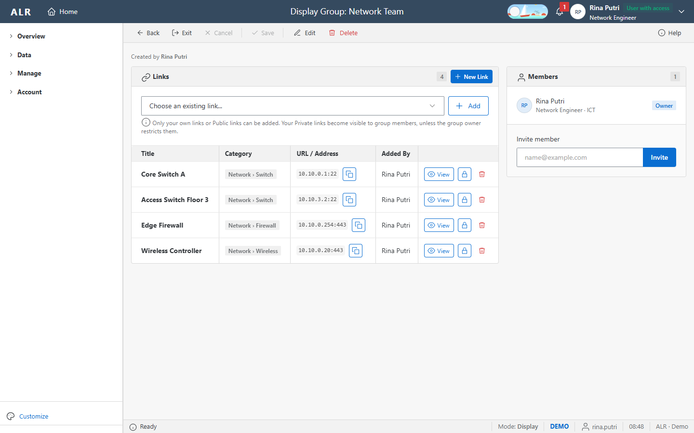
      </picture>
      <p align="center"><b>Group Detail</b><br><sub>Share selected links with invited members</sub></p>
    </td>
  </tr>
  <tr>
    <td width="50%" valign="top">
      <picture>
        <source media="(prefers-color-scheme: dark)" srcset=".github/assets/settings-dark.png">
        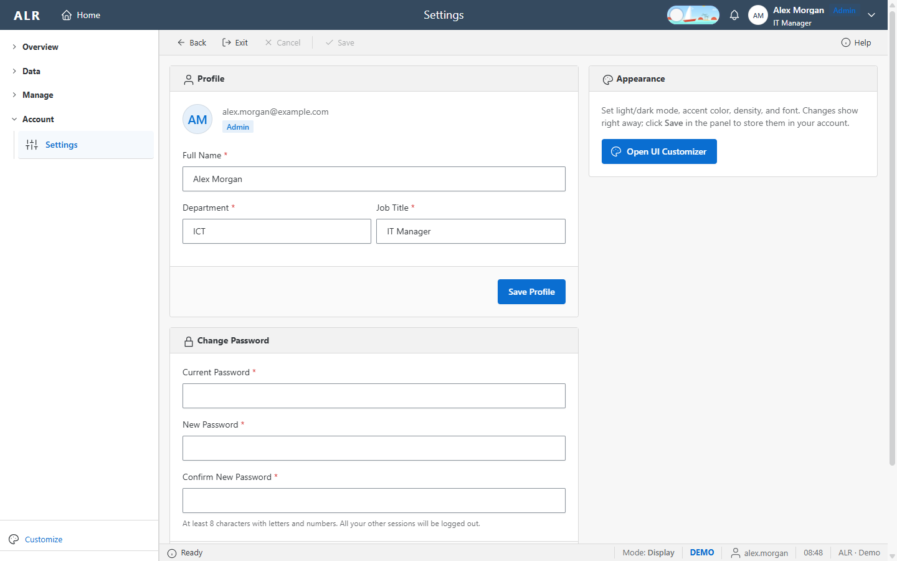
      </picture>
      <p align="center"><b>Settings</b><br><sub>Profile maintenance and password change</sub></p>
    </td>
    <td width="50%" valign="top">
      <picture>
        <source media="(prefers-color-scheme: dark)" srcset=".github/assets/help-dark.png">
        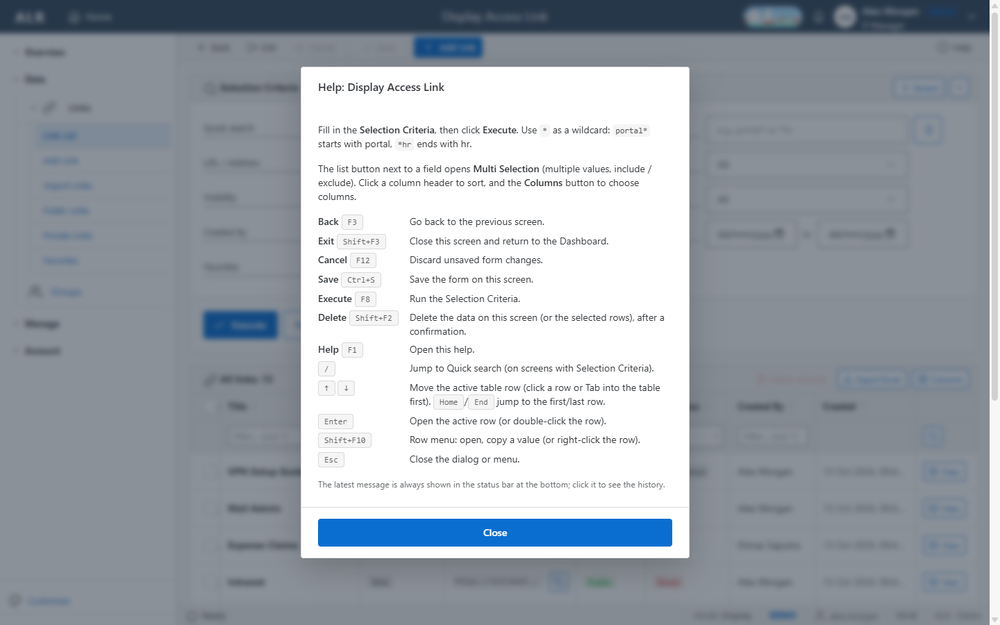
      </picture>
      <p align="center"><b>Help (F1)</b><br><sub>Context help and the complete keyboard reference</sub></p>
    </td>
  </tr>
</table>
</details>

<br>

## Features

Expand a module to view its capabilities.

<details>
<summary><b>Link Register</b> &nbsp;·&nbsp; the core record</summary>
<br>

| Capability | Description |
|---|---|
| Record types | URL, host or IP address with port, or a structured guide with up to ten custom fields written in a Word-style rich text editor (sanitized and not encrypted, so never meant for passwords) |
| Categorization | Hierarchical categories up to four levels deep (for example, Web › ERP), selected through cascading inputs |
| Visibility | Private (owner, plus administrators read-only) or Public (all users, read-only); only administrators can create Public links, so links from other users, including imported ones, are saved as Private |
| Access note | A short access hint (for example, sign in via SSO), not a password; encrypted in the database and masked until a user explicitly reveals it |
| Attachments | Up to five files per record: images, PDF, Excel, Word, and plain text |
| Favorites | Bookmark records and filter the list to favorites only |
| Archive | Move unused links to the archive; archived links stay visible with an Archived badge, are always listed below active links, and can be restored |
| History | Chronological record of creation and modification per link |
| Import | Excel template with validated dropdowns; rows are processed in a single all-or-nothing transaction |
| Export | Excel workbook of the current search result, including a summary sheet |

</details>

<details>
<summary><b>SAP GUI Conventions</b> &nbsp;·&nbsp; familiar to ERP users</summary>
<br>

| Element | Description |
|---|---|
| Application toolbar | Back, Exit, Cancel, Save, and Help in fixed positions; unavailable actions are disabled |
| Function keys | Every toolbar action is bound to a key (see [Keyboard Reference](#keyboard-reference)) |
| Selection screen | Search criteria with wildcard patterns (`ad*`, `*ad`, `*ad*`) and multiple values per field |
| Variants | Named, reusable sets of selection criteria per screen |
| ALV-style table | Sorting, per-column filters, adjustable and hideable columns persisted per user, active row, context menu |
| Status bar | Message history, screen mode, environment, current user, and clock |

</details>

<details>
<summary><b>Role-Based Dashboards</b> &nbsp;·&nbsp; tailored to each role</summary>
<br>

| Role | Dashboard Content |
|---|---|
| Administrator | User totals, locked and inactive accounts, link availability, last check time, and an administrative task list |
| User Entry | Personal metrics, items requiring attention, and an onboarding guide |

Every role includes a **team activity feed**. Repeated actions are consolidated into a single entry per person per day to keep the feed concise. Regular users see public activity only; account and security events are restricted to administrators.

</details>

<details>
<summary><b>Groups</b> &nbsp;·&nbsp; controlled sharing</summary>
<br>

- Create groups and invite members by email; invitations can be accepted or declined
- Share owned or public links with a group
- Restrict an individual shared link to selected members
- Group owners decide which members may contribute links

</details>

<details>
<summary><b>Link Monitoring</b> &nbsp;·&nbsp; availability checks</summary>
<br>

- Administrators queue a check from the web interface; a dedicated worker process executes it
- Progress is reported in real time; results appear as Up, Down, or Not Checked throughout the application
- Every target, including each redirect hop, is validated against private, loopback, and cloud metadata address ranges

</details>

<details>
<summary><b>Account and Identity</b> &nbsp;·&nbsp; authentication and preferences</summary>
<br>

- Self-registration restricted to the corporate email domain, confirmed by a verification code
- Two-step sign-in: password followed by a one-time code delivered by email
- Password recovery, password change, and profile maintenance
- In-app notifications for group invitations and membership changes, blocked sign-in attempts, and password changes
- Light and dark themes, accent colors, font selection, and a compact layout

</details>

<br>

## Access Control

The system defines two roles: User Entry and Administrator. Permissions are not granted per user; every management screen is restricted to administrators.

<div align="center">

| Action | User Entry | Administrator |
|---|:---:|:---:|
| Create, edit, and delete own links | ✓ | ✓ |
| Create public links | – | ✓ |
| View and copy public links | ✓ | ✓ |
| View other users' private links | – | – |
| Create groups and share links | ✓ | ✓ |
| Import and export Excel files | ✓ | ✓ |
| Manage categories | – | ✓ |
| Edit or delete other users' public links | – | ✓ |
| View audit logs | – | ✓ |
| Manage users | – | ✓ |
| Run link monitoring | – | ✓ |
| Delete links in bulk | – | ✓ |

</div>

Private links are hidden from other users; administrators can view them read-only but cannot edit, archive, delete, or share them. Administrator accounts can only be provisioned through the command line.

<br>

## Keyboard Reference

<div align="center">

| Key | Action | Key | Action |
|:---:|---|:---:|---|
| <kbd>F3</kbd> | Back | <kbd>F1</kbd> | Context help |
| <kbd>Shift</kbd> + <kbd>F3</kbd> | Exit to dashboard | <kbd>/</kbd> | Focus quick search |
| <kbd>F12</kbd> | Cancel changes | <kbd>↑</kbd> <kbd>↓</kbd> | Move active table row |
| <kbd>Ctrl</kbd> + <kbd>S</kbd> | Save | <kbd>Enter</kbd> | Open active row |
| <kbd>F8</kbd> | Execute selection | <kbd>Shift</kbd> + <kbd>F10</kbd> | Row context menu |
| <kbd>Shift</kbd> + <kbd>F2</kbd> | Delete | <kbd>Esc</kbd> | Close dialog or menu |

</div>

<br>

## Architecture

Expand a diagram to view it. GitHub renders each diagram with zoom and pan controls.

<details>
<summary><b>System Context</b></summary>
<br>

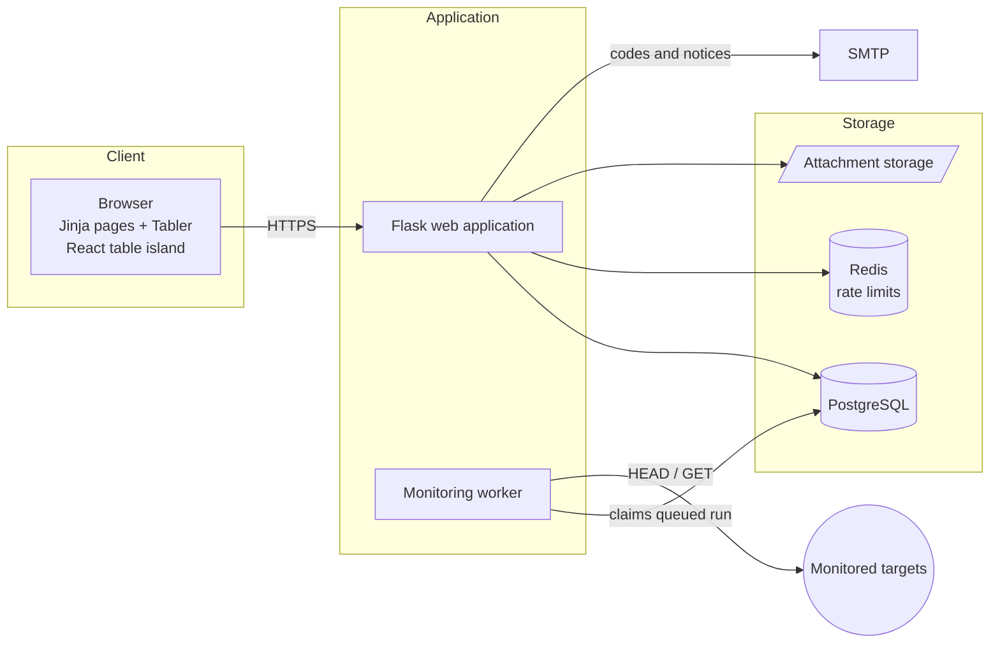

The web application and the monitoring worker run as independent processes and coordinate exclusively through the database, so long-running checks never occupy a web request.

</details>

<details>
<summary><b>Application Layers</b></summary>
<br>

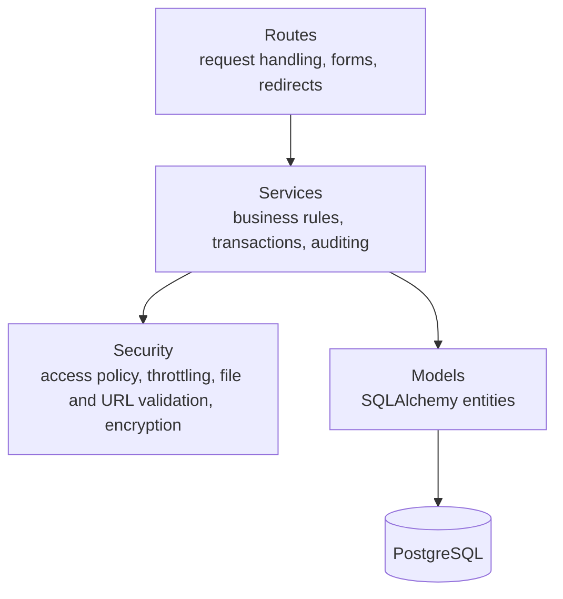

| Module | Responsibility |
|---|---|
| `app/routes/` | HTTP boundary: input parsing, responses, and redirects. Contains no business logic. |
| `app/services/` | Business rules, transaction boundaries, and audit logging |
| `app/security/` | Access policy, rate limiting, upload validation, outbound URL validation, and encryption |
| `app/models/` | Entities and constraints; all schema changes are versioned with Alembic |
| `app/schemas/` | Form and selection screen definitions |
| `frontend/` | React 19 and Vite source for the link table, compiled into `app/static/dist` |

</details>

<details>
<summary><b>Data Model</b></summary>
<br>

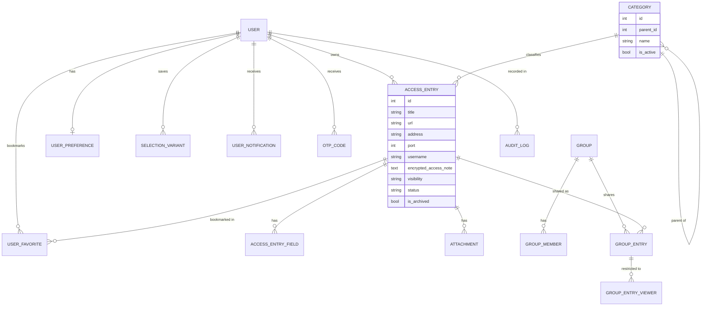

Categories are modeled as a self-referencing adjacency list (`parent_id`), allowing users to add sub-categories at any level without schema changes.

</details>

<details>
<summary><b>Visibility Rule</b></summary>
<br>

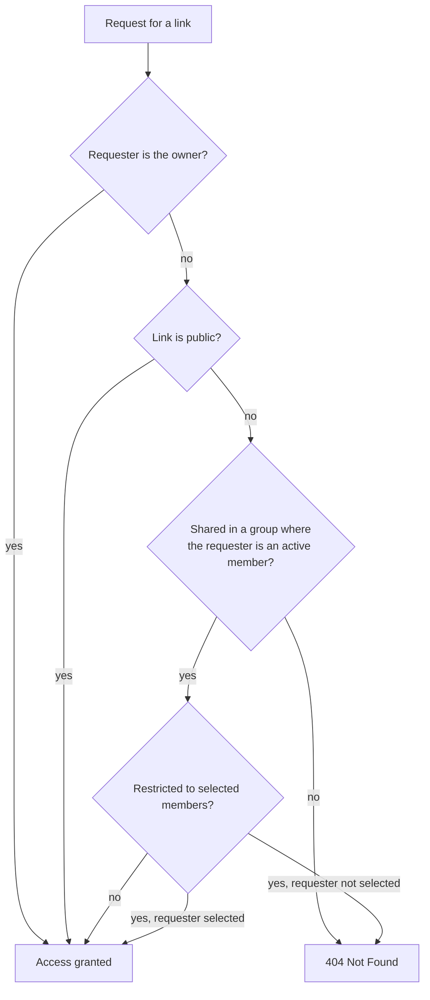

This rule is implemented as a single SQL predicate reused by every list, count, search, export, and detail view, which guarantees consistent results. Inaccessible records return 404 so that their existence is not disclosed.

</details>

<details>
<summary><b>Sign-In Sequence</b></summary>
<br>

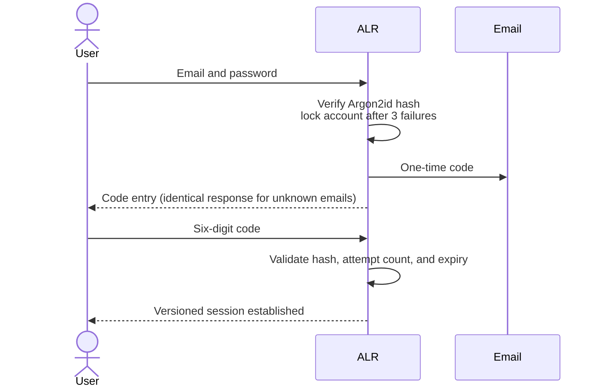

</details>

<details>
<summary><b>Password Recovery Sequence</b></summary>
<br>

```mermaid
sequenceDiagram
    actor U as User
    participant A as ALR
    participant E as Email
    U->>A: Email address
    A-->>U: Neutral response ("If the email is registered, a code was sent")
    A->>E: Reset code (active accounts only)
    U->>A: Code and new password
    A->>A: Validate code; enforce per-code and per-email limits
    A->>A: Store new hash, revoke all sessions, unlock account
    A->>E: Password change notice
    A-->>U: Redirect to sign-in
```

Reset codes and sign-in codes are stored under separate purposes and can never be used interchangeably.

</details>

<details>
<summary><b>Link Monitoring Sequence</b></summary>
<br>

```mermaid
sequenceDiagram
    actor Ad as Administrator
    participant W as Web application
    participant DB as Database
    participant K as Worker
    participant T as Target
    Ad->>W: Start availability check
    W->>DB: Enqueue a single run
    K->>DB: Claim queued run
    loop for each link
        K->>K: Validate target address
        K->>T: Request; validate every redirect hop
        K->>DB: Persist status and progress
    end
    Ad->>W: Poll run status
    W-->>Ad: Live progress, then summary
```

</details>

<details>
<summary><b>Excel Import Pipeline</b></summary>
<br>

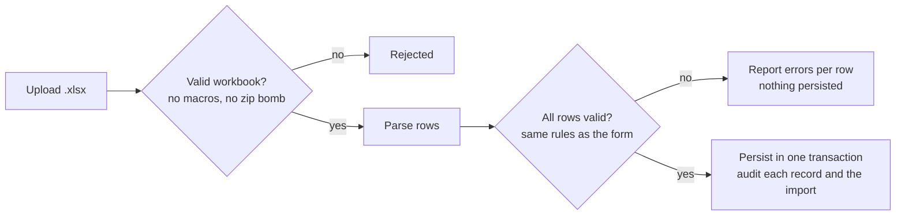

</details>

<br>

## Security

<div align="center">

| Threat | Mitigation |
|---|---|
| Database disclosure | Access notes encrypted with Fernet (AES); passwords hashed with Argon2id; one-time codes stored as hashes |
| Account enumeration | Sign-in, registration, and password recovery return identical responses for known and unknown emails |
| Credential brute force | Rate limiting per IP and per email; three failed password or code attempts lock the account for 15 minutes, and an administrator can unlock it earlier |
| Session hijacking | Versioned sessions; a password change or reset revokes all other sessions |
| Unauthorized data access | One shared visibility predicate for all queries; inaccessible data returns 404 |
| Access note exposure | Access notes are excluded from page markup; each reveal is a separate authorized request |
| Cross-site scripting | Input sanitization and a Content Security Policy restricted to first-party scripts |
| Cross-site request forgery | Tokens on every form submission and JSON request |
| Malicious uploads | File signature verification, macro and zip bomb detection, and XXE-safe Excel parsing |
| Server-side request forgery | Private, loopback, and metadata ranges blocked, including redirects and IPv6 |
| Race conditions | Row-level locks on critical updates, verified on PostgreSQL with concurrent requests |
| Audit tampering | Audit records cannot be modified or deleted through the application |

</div>

<br>

## Design Decisions

<details>
<summary><b>Adjacency list for categories</b></summary>
<br>

Users create their own sub-categories, so the hierarchy depth is not fixed. A single self-referencing table supports any level with uniform queries. Depth is limited to four in the service layer, and the complete tree is small enough to load once per request and assemble in memory.

</details>

<details>
<summary><b>React island instead of a single-page application</b></summary>
<br>

Most screens are forms and lists that are well served by server rendering. Only the link table requires rich client-side behavior (column layout, active row, context menu, live filtering), so React is limited to that component. Compiled assets are committed, so running the application does not require Node.js.

</details>

<details>
<summary><b>A single visibility predicate</b></summary>
<br>

When lists, counts, exports, and detail pages each enforce access independently, the rules diverge over time and data leaks. One predicate is shared by all of them, and the test suite verifies that a private link never appears anywhere for an unauthorized user.

</details>

<details>
<summary><b>Dedicated monitoring worker</b></summary>
<br>

Checking hundreds of targets can take several minutes. Executing that work inside a web request would cause timeouts and exhaust web workers. The interface only enqueues a run; the worker claims it, persists progress, and can recover an interrupted run.

</details>

<details>
<summary><b>On-demand access note retrieval</b></summary>
<br>

Embedding an access note in page markup exposes it to anyone who can read the page source, including browser caches and extensions. Retrieving it only when a user selects Show or Copy keeps it out of the markup.

</details>

<br>

## Quality Assurance

<div align="center">

| Suite | Tooling | Count | Scope |
|---|---|:---:|---|
| Backend | pytest | 731 | Services, routes, authorization, and security scenarios |
| Database concurrency | pytest on PostgreSQL | 6 | Concurrent requests, row locks, and unique constraints |
| Frontend | Vitest, Testing Library | 46 | Link table, columns, selection, and keyboard behavior |
| End-to-end | Headless Chrome | 9 scenarios | Authentication, tables, accounts, categories, groups, monitoring, rich text editor, and function keys |

</div>

Each feature is tested for the expected flow and for misuse: incorrect roles, access to another user's private data, invalid input, and duplicate submissions. The CI pipeline runs the backend, PostgreSQL, and frontend suites together with secret detection on every push.

<br>

## Project Structure

<details>
<summary><b>Repository layout</b></summary>
<br>

```text
.
├── app/
│   ├── models/         SQLAlchemy entities (17 tables)
│   ├── routes/         Blueprints: auth, entries, categories, groups, users, audit, monitoring, settings
│   ├── schemas/        Form and selection screen definitions
│   ├── security/       Access policy, throttling, file and URL validation, encryption
│   ├── services/       Business rules, import and export, link checking, notifications
│   ├── static/         Stylesheets, scripts, and the compiled React table (dist/)
│   ├── templates/      Jinja layouts, components, and pages
│   ├── utils/          Constants and shared helpers
│   ├── cli.py          Administrative and maintenance commands
│   └── config.py       Environment-specific configuration
├── frontend/           React 19 and Vite source for the link table
├── migrations/         Alembic migrations
├── scripts/e2e/        End-to-end scenarios (headless Chrome)
├── tests/              pytest suites
└── run.py              Application entry point
```

</details>

<br>

## Getting Started

<details>
<summary><b>Local setup</b></summary>
<br>

Prerequisites: Python 3.13 and PostgreSQL 17. Node.js 24 is required only to modify the React table.

```bash
python -m venv .venv
# Windows: .venv\Scripts\activate
# macOS/Linux: source .venv/bin/activate
pip install -r requirements-dev.txt

cp .env.example .env
# Configure SECRET_KEY, DATABASE_URL, and ENCRYPTION_KEY. Generate an encryption key with:
python -c "from cryptography.fernet import Fernet; print(Fernet.generate_key().decode())"

flask --app run db upgrade
flask --app run seed-categories
flask --app run create-admin
flask --app run run
```

</details>

<details>
<summary><b>Command-line interface</b></summary>
<br>

| Command | Purpose |
|---|---|
| `create-admin` | Provision the initial administrator account |
| `set-admin` / `unset-admin` | Promote or demote an account |
| `seed-categories` | Create the built-in categories |
| `monitor-worker` | Run the link monitoring worker as a long-lived process |
| `check-links` | Execute a single availability check from the terminal |
| `recover-link-monitor` | Recover an interrupted monitoring run |
| `cleanup-attachments` | Detect and remove orphaned attachment files |
| `cleanup-old-data` | Purge expired codes and obsolete records |

Invoke each command as `flask --app run <command>`.

</details>

<details>
<summary><b>Running the test suites</b></summary>
<br>

```bash
pytest -q                          # backend
cd frontend && npm ci && npm test  # frontend
node scripts/e2e/table.mjs         # an end-to-end scenario (requires Chrome)
```

</details>

<br>

## Author

**Mochammad Bisma Prasetya** &nbsp;·&nbsp; [github.com/Masbismaa](https://github.com/Masbismaa)
